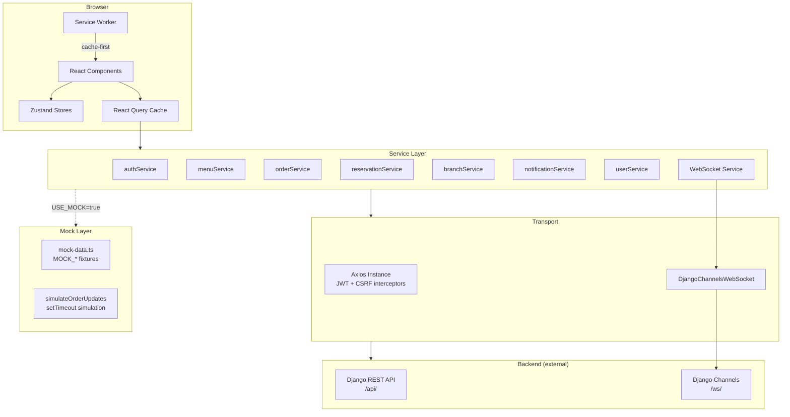
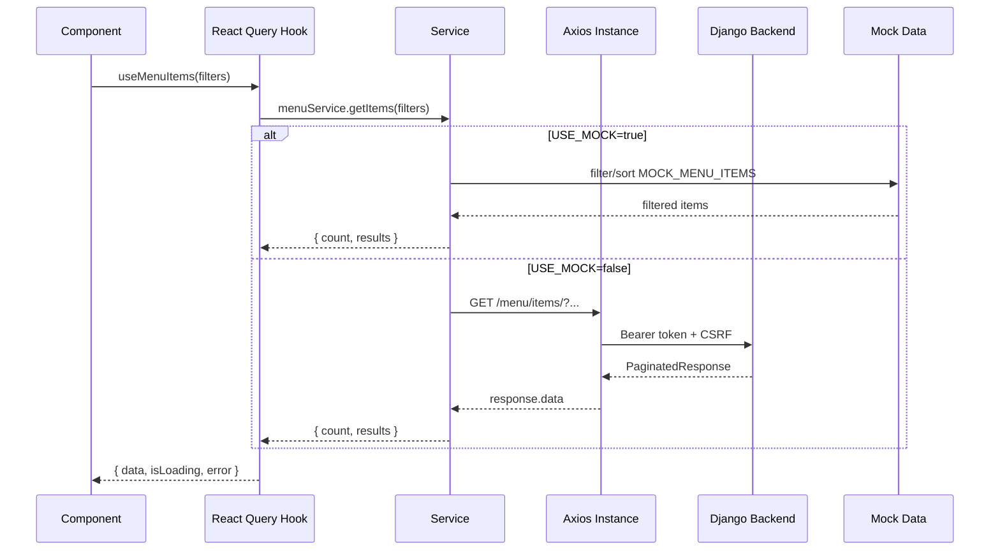
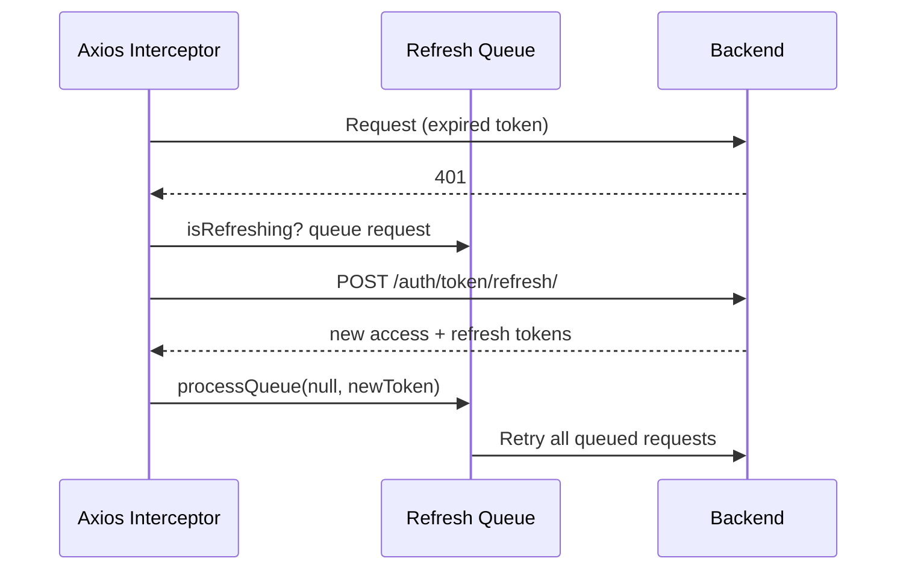
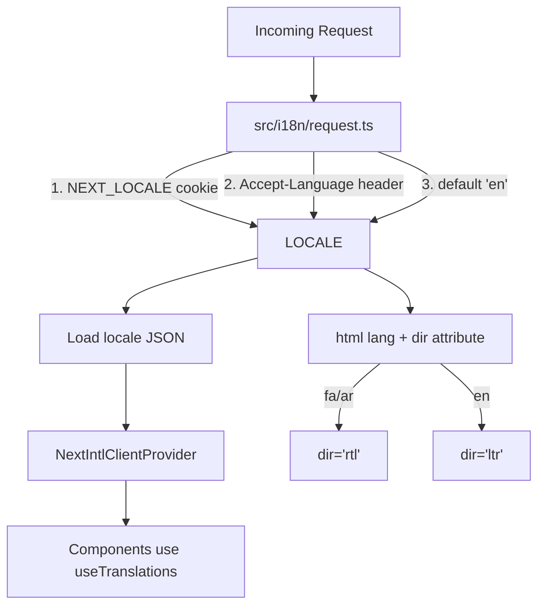
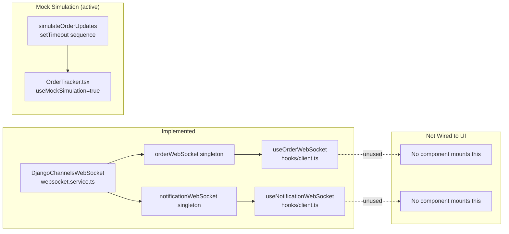
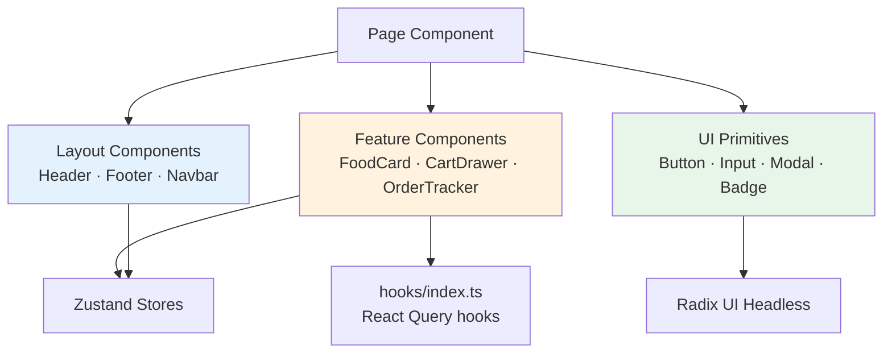

# Architecture — Savor Frontend

> Comprehensive architecture documentation for the Savor restaurant web application. All diagrams and descriptions are derived from actual source code analysis.

---

## Table of Contents

1. [System Overview](#system-overview)
2. [Architectural Style](#architectural-style)
3. [High-Level Architecture](#high-level-architecture)
4. [Frontend Architecture](#frontend-architecture)
5. [Module Boundaries](#module-boundaries)
6. [Folder Structure](#folder-structure)
7. [State Management Architecture](#state-management-architecture)
8. [API Layer Architecture](#api-layer-architecture)
9. [Localization Architecture](#localization-architecture)
10. [Realtime Architecture](#realtime-architecture)
11. [Routing Architecture](#routing-architecture)
12. [Component Architecture](#component-architecture)
13. [Build Architecture](#build-architecture)
14. [Deployment Architecture](#deployment-architecture)
15. [Key Design Decisions](#key-design-decisions)
16. [Architecture Weaknesses](#architecture-weaknesses)
17. [Scalability Limitations](#scalability-limitations)

---

## System Overview

Savor is a **Next.js 15 App Router** frontend for a hospitality SaaS platform. The current codebase is deployed as a single-tenant restaurant application; the roadmap direction is toward a multi-tenant platform supporting multiple hospitality business types (restaurant, cafe, bar, hotel, and others) through a configurable Tenant / Location / Module architecture. See [ROADMAP.md](./ROADMAP.md) for the full platform direction and completion status.

The frontend communicates with a Django REST Framework + Django Channels backend over HTTPS (REST) and WSS (WebSocket). A built-in **mock mode** allows the entire application to run without a backend by returning simulated data with artificial delays.

```
┌─────────────────────────────────────────────────────────────────┐
│                        Browser (Client)                         │
│  Next.js 15 App Router + React 19 + Zustand + React Query       │
└────────────────────────────┬────────────────────────────────────┘
                             │ HTTP/HTTPS  │  WSS
                             ▼            ▼
┌────────────────────────────────────────────────────────────────┐
│                    Nginx Reverse Proxy                          │
│  Rate limiting · Static asset caching · SSL termination        │
└────┬───────────────────────────────────────────┬───────────────┘
     │ /  (Next.js)                             │ /api/ + /ws/ (Django)
     ▼                                          ▼
┌──────────────────┐                 ┌──────────────────────────┐
│  Next.js :3000   │                 │  Django + Channels :8000  │
│  (Docker)        │                 │  (External service)       │
└──────────────────┘                 └──────────────────────────┘
```

---

## Architectural Style

- **Rendering:** Hybrid — Server Components for layout/metadata/i18n; Client Components for all interactive UI
- **Data Fetching:** Client-side via TanStack React Query (no server-side `fetch` in RSC data patterns)
- **State:** Two-tier — Zustand (global UI/user state) + React Query (server cache)
- **API Mode:** Toggle between real backend and mock mode via environment variable
- **Real-time:** WebSocket via native `WebSocket` API wrapped in a custom class (not Socket.IO despite the package being installed)
- **Styling:** Tailwind CSS v4 with CSS custom properties for theming (no Tailwind config file — uses PostCSS plugin)

---

## High-Level Architecture



---

## Frontend Architecture

```mermaid
graph LR
    subgraph AppRouter["Next.js App Router (src/app/)"]
        LAYOUT[layout.tsx\nProviders + i18n]
        HOME[page.tsx\nLanding]
        MENU_PAGE[menu/page.tsx]
        CHECKOUT[checkout/page.tsx]
        DASH[dashboard/layout.tsx]
        ADMIN[admin/*]
        AUTH_PAGES[login / register / ...]
        TABLE[table/[tableId]]
        ORDER_PAGE[order/[orderId]]
    end

    subgraph Providers["src/providers/index.tsx"]
        QCP[QueryClientProvider]
        THEME_P[ThemeProvider]
        RTL_P[RTLProvider]
        AUTH_B[AuthBootstrapper]
        TOAST[Toaster]
    end

    subgraph Stores["src/stores/index.ts"]
        AUTH_S[useAuthStore]
        CART_S[useCartStore]
        THEME_S[useThemeStore]
        LANG_S[useLangStore]
        BRANCH_S[useBranchStore]
        NOTIF_S[useNotificationStore]
        FAV_S[useFavoritesStore]
        RECENT_S[useRecentlyViewedStore]
    end

    LAYOUT --> Providers
    Providers --> AppRouter
    AppRouter --> Stores
```

### Provider Bootstrap Sequence

On initial page load, `AuthBootstrapper` (mounted in `Providers`):

1. Reads `access_token` from `localStorage`
2. If present, calls `authService.getMe()` → sets `useAuthStore.user`
3. Simultaneously fetches `userService.getFavorites()` → hydrates `useFavoritesStore`
4. Listens for `auth:logout` custom DOM event (dispatched by Axios interceptor on unrecoverable 401)

`ThemeProvider` and `RTLProvider` apply CSS class / `dir` attribute changes reactively as their respective Zustand stores update.

---

## Module Boundaries

```
src/
├── app/           → Route segments (page, layout, error, not-found)
│                     Each page owns its own data-fetching via hooks
├── components/    → Reusable UI (no direct store access in primitives,
│                     store access allowed in feature components)
├── hooks/         → React Query hooks (index.ts) + client utility hooks (client.ts)
│                     Bridge between services and components
├── services/      → Network layer — no React, no stores
│                     All mock branching lives here
├── stores/        → Zustand state — no network calls
├── providers/     → React context/provider setup + auth bootstrapping
├── lib/           → Static fixtures (mock-data.ts)
├── constants/     → App-wide constants (URLs, keys, rates)
├── types/         → TypeScript interfaces (no runtime code)
├── utils/         → Pure functions (formatting, debounce, cn)
├── i18n/          → next-intl config + translation JSON
└── test/          → Vitest test files
```

### Dependency Rules (intended)

```
app → hooks → services → axios.instance
app → components → hooks/stores
stores → types/constants
services → types/constants/mock-data
```

**Violation found:** `src/app/admin/*` pages import directly from `@/lib/mock-data` rather than going through services, bypassing the service layer entirely.

---

## Folder Structure

```
.
├── src/
│   ├── app/
│   │   ├── layout.tsx                  # Root layout + providers + i18n
│   │   ├── page.tsx                    # Home/landing page
│   │   ├── globals.css                 # Tailwind directives + CSS custom properties
│   │   ├── sitemap.ts                  # Dynamic sitemap generation
│   │   ├── error.tsx                   # Global error boundary
│   │   ├── not-found.tsx               # 404 page
│   │   ├── offline/page.tsx            # PWA offline fallback
│   │   ├── login/page.tsx
│   │   ├── register/page.tsx
│   │   ├── forgot-password/page.tsx
│   │   ├── verify-otp/page.tsx
│   │   ├── menu/page.tsx               # Full menu browser
│   │   ├── restaurant/page.tsx         # About / restaurant info
│   │   ├── reservation/page.tsx        # Booking form
│   │   ├── checkout/
│   │   │   ├── page.tsx                # Multi-step checkout
│   │   │   ├── success/page.tsx        # Order confirmed + tracker
│   │   │   └── failure/page.tsx        # Payment failure
│   │   ├── order/[orderId]/page.tsx    # Order detail + tracker
│   │   ├── table/[tableId]/page.tsx    # QR dine-in entry
│   │   ├── dashboard/
│   │   │   ├── layout.tsx              # Sidebar layout
│   │   │   ├── page.tsx                # Overview
│   │   │   ├── orders/page.tsx
│   │   │   ├── reservations/page.tsx
│   │   │   ├── favorites/page.tsx
│   │   │   ├── addresses/page.tsx
│   │   │   └── settings/page.tsx
│   │   ├── admin/
│   │   │   ├── stats/page.tsx          # [UI_ONLY] KPI dashboard
│   │   │   ├── orders/page.tsx         # [UI_ONLY] Order board
│   │   │   ├── menu/page.tsx           # [UI_ONLY] Menu management
│   │   │   ├── customers/page.tsx      # [UI_ONLY] Customer list
│   │   │   └── reservations/page.tsx   # [UI_ONLY] Reservation management
│   │   └── api/health/route.ts         # Health check endpoint
│   ├── components/
│   │   ├── layout/                     # Header, Navbar, Footer, MainLayout
│   │   ├── menu/                       # FoodCard, FoodDetailModal
│   │   ├── cart/                       # CartDrawer, FloatingCart
│   │   ├── order/                      # OrderTracker
│   │   ├── notification/               # NotificationCenter
│   │   ├── common/                     # BranchSelector, PageTransition, JsonLd
│   │   └── ui/                         # Button, Input, Modal, Badge, Card, ...
│   ├── hooks/
│   │   ├── index.ts                    # React Query hooks (auth, menu, order, etc.)
│   │   └── client.ts                   # WebSocket hooks + utility hooks
│   ├── services/
│   │   ├── axios.instance.ts           # Axios + JWT/CSRF interceptors + refresh logic
│   │   ├── endpoints.ts                # All API endpoint constants
│   │   ├── auth.service.ts             # Authentication methods
│   │   ├── menu.service.ts             # Menu data methods
│   │   ├── order.service.ts            # Order CRUD
│   │   ├── combined.service.ts         # reservation, branch, notification, user
│   │   └── websocket.service.ts        # WebSocket class + mock simulation
│   ├── stores/index.ts                 # All Zustand stores
│   ├── providers/index.tsx             # QueryClient + Theme + RTL + Auth bootstrap
│   ├── lib/mock-data.ts                # All mock fixtures
│   ├── constants/index.ts              # App constants
│   ├── types/index.ts                  # TypeScript types (no runtime code)
│   ├── utils/index.ts                  # Pure utility functions
│   ├── i18n/
│   │   ├── request.ts                  # next-intl locale detection
│   │   └── locales/                    # en.json, fa.json, ar.json
│   └── test/
│       ├── setup.ts
│       └── index.test.ts               # Utility + cart store tests
├── public/
│   ├── sw.js                           # Service worker (hand-written)
│   ├── manifest.json                   # PWA manifest
│   └── robots.txt
├── next.config.ts                      # Next.js + next-intl config
├── tsconfig.json                       # TypeScript config (paths: @/)
├── eslint.config.mjs                   # ESLint (Next.js defaults)
├── postcss.config.mjs                  # @tailwindcss/postcss
├── Dockerfile                          # Multi-stage Docker build
├── docker-compose.yml                  # Production stack
├── docker-compose.dev.yml              # Development stack
├── nginx.conf                          # Production Nginx config
└── .env.example                        # Environment variable documentation
```

---

## State Management Architecture

```mermaid
graph TD
    subgraph Persisted["Persisted (localStorage)"]
        CART[useCartStore\nitems · discount · isOpen]
        THEME[useThemeStore\ntheme: light|dark|system]
        LANG[useLangStore\nlocale: en|fa|ar]
        BRANCH[useBranchStore\nactiveBranch]
        FAV[useFavoritesStore\nfavorites: Set<string>]
        RECENT[useRecentlyViewedStore\nitems: MenuItem[]]
    end

    subgraph InMemory["In-Memory Only"]
        AUTH[useAuthStore\nuser · isAuthenticated · isLoading]
        NOTIF[useNotificationStore\nnotifications · unreadCount]
    end

    subgraph ReactQuery["React Query (server cache)"]
        MENU_Q[menu-items · categories]
        ORDER_Q[orders · order detail]
        RES_Q[reservations]
        BRANCH_Q[branches]
        NOTIF_Q[notifications — polls 60s]
        USER_Q[addresses · favorites]
    end

    AUTH -->|hydrated on mount| AuthBootstrapper
    FAV -->|synced from server| ReactQuery
    NOTIF -->|updated by| NOTIF_Q
    CART -->|cleared on| ORDER_Q
```

### Cart Total Computation

Cart totals are computed as **derived state** via getter functions, not stored:

```
subtotal = sum(item.unit_price * item.quantity)
tax      = subtotal × TAX_RATE (0.09)
service  = subtotal × SERVICE_CHARGE_RATE (0.05)
total    = subtotal - discountAmount + tax + service
```

Constants `TAX_RATE` and `SERVICE_CHARGE_RATE` are hardcoded in `src/constants/index.ts`.

---

## API Layer Architecture



### Token Refresh Flow



---

## Localization Architecture



**Font strategy:**
- Latin scripts: DM Sans (body) + Playfair Display (display/headings)
- Arabic/Persian: Vazirmatn loaded unconditionally in `layout.tsx`

**Locale switching:** The `useLangStore.setLocale()` action sets `document.documentElement.lang` and `dir` immediately (client-side), but the Next.js locale is read server-side from the cookie. A page reload is required for server-rendered translations to update.

---

## Realtime Architecture



**Current state:** Real-time updates are simulated via `setTimeout` sequences. The WebSocket infrastructure is fully implemented but never activated in the UI.

---

## Routing Architecture

```mermaid
graph TD
    ROOT[/ Root Layout\nsrc/app/layout.tsx]
    ROOT --> HOME[/ Home]
    ROOT --> MENU[/menu]
    ROOT --> RESTO[/restaurant]
    ROOT --> RES[/reservation]
    ROOT --> TABLE[/table/tableId]
    ROOT --> CO[/checkout/*]
    ROOT --> ORDER[/order/orderId]
    ROOT --> AUTH[Auth Routes\n/login /register\n/forgot-password\n/verify-otp]
    ROOT --> DASH[/dashboard\nsrc/app/dashboard/layout.tsx]
    ROOT --> ADMIN[/admin/*]
    ROOT --> API[/api/health]

    DASH --> DASH_HOME[/dashboard]
    DASH --> ORDERS[/dashboard/orders]
    DASH --> RESERV[/dashboard/reservations]
    DASH --> FAV[/dashboard/favorites]
    DASH --> ADDR[/dashboard/addresses]
    DASH --> SETT[/dashboard/settings]
```

**Route protection status:**
- All routes are publicly accessible
- No Next.js `middleware.ts` exists
- Auth check in individual components is ad-hoc (not enforced)

---

## Component Architecture



### UI Primitive Layer

Built on **Radix UI** headless components with custom Tailwind styling. Key primitives:

- `Button` — variants: default/secondary/outline/ghost/destructive, sizes: sm/md/lg/icon
- `Input` — with label, error, icon slots
- `Modal` — Radix Dialog with custom styling
- `Badge` — variants: default/secondary/success/warning/danger/info/purple
- `Card` — semantic container
- `Avatar`, `Skeleton`, `Divider`, `FoodCardSkeleton`

---

## Build Architecture

```mermaid
graph LR
    TS[TypeScript\nsrc/**/*.ts(x)] --> SWC[SWC Compiler]
    CSS[globals.css\nTailwind v4] --> POSTCSS[@tailwindcss/postcss]
    SWC --> NEXT[Next.js Build]
    POSTCSS --> NEXT
    NEXT -->|output: standalone| SA[.next/standalone/]
    SA --> DOCKER[Docker Runner\nnode server.js]
```

**Build configuration (`next.config.ts`):**
- `output: "standalone"` — self-contained deployment artifact
- `optimizeCss: true` — uses `critters` for critical CSS inlining
- Image domains: `images.unsplash.com`, `res.cloudinary.com`, `*.amazonaws.com`, `localhost`
- Security headers applied to all routes
- `next-intl` plugin wraps the config

**TypeScript:** Path alias `@/` maps to `src/`. Strict mode is enabled.

---

## Deployment Architecture

```
┌─────────────────────────────────────────────────────────────────┐
│                         Docker Host                             │
│                                                                 │
│  ┌──────────────────────┐    ┌──────────────────────────────┐   │
│  │    savor-nginx       │    │        savor-app             │   │
│  │  (nginx:alpine)      │    │  (node:22-alpine)            │   │
│  │  ports: 80, 443      │    │  port: 3000 (internal)       │   │
│  │  ./nginx.conf        │    │  NODE_ENV=production         │   │
│  │  cache: nginx-cache  │    │  user: nextjs (uid 1001)     │   │
│  └──────────┬───────────┘    └──────────────────────────────┘   │
│             │ savor-net                                          │
│  ┌──────────┴──────────────────────────────────────────────┐    │
│  │                   shared-net (external)                  │    │
│  │              Django backend service lives here           │    │
│  └─────────────────────────────────────────────────────────┘    │
│                                                                  │
│  Volumes:                                                        │
│    nginx-cache         (internal)                               │
│    backend_static_volume (external — created by Django service) │
└─────────────────────────────────────────────────────────────────┘
```

**Network topology:**
- `savor-net` — internal bridge for Next.js ↔ Nginx
- `shared-net` — external bridge shared with Django backend service
- `static_volume` — external volume mounted from the Django container, served by Nginx at `/static/`

---

## Key Design Decisions

### 1. Mock Mode as a First-Class Feature

Every service method has a dual code path: real API or mock. This is controlled by `NEXT_PUBLIC_USE_MOCK`. The mock path returns rich, realistic data with artificial delays. This decision enables:
- Frontend development without a running backend
- Demo deployments
- **Risk:** Production deployment with mock mode accidentally left on

### 2. Zustand + React Query Separation

Global UI state (cart, theme, auth user) lives in Zustand. Server-sourced data (menu items, orders, reservations) lives in React Query. The two are bridged in hooks (e.g., `useNotifications` updates the Zustand notification store from the React Query response).

### 3. CSS Custom Properties for Theming

Instead of Tailwind dark mode classes on every element, the app uses CSS variables (`--bg`, `--fg`, `--card`, `--border`, etc.) that change their values based on the `dark` class on `<html>`. This keeps component markup clean but means the design system lives entirely in `globals.css`.

### 4. Logical CSS Properties for RTL

All directional CSS uses Tailwind logical property classes (`ps-`, `pe-`, `ms-`, `me-`, `start-`, `end-`) instead of `pl-`, `pr-`, `ml-`, `mr-`, `left-`, `right-`. This means RTL layout works automatically when `dir="rtl"` is set.

### 5. Hand-Written Service Worker

Despite `next-pwa` being listed as a dependency, the service worker is a hand-written `public/sw.js`. This gives full control but means `next-pwa`'s versioning, injection, and Workbox features are unused.

### 6. JWT in localStorage (Security Trade-off)

Tokens are stored in `localStorage` for simplicity. This is vulnerable to XSS. The mitigating factors are: strict CSP (not yet implemented) and the security headers (`X-XSS-Protection`, `X-Content-Type-Options`). The alternative (httpOnly cookies) would require backend coordination.

### 7. DjangoChannelsWebSocket vs Socket.IO

Despite `socket.io-client` being installed, all WebSocket code uses the native `WebSocket` browser API wrapped in a custom class. This is correct for Django Channels (which uses native WebSocket protocol) but makes the Socket.IO dependency dead code.

---

## Architecture Weaknesses

| Weakness | Description | Severity |
|----------|-------------|----------|
| No Tenant / Location / Module abstraction | No concept of `Tenant`, `Location`, or `Module` exists; every model, route, and service assumes exactly one restaurant business — adding a second tenant or business type today requires forking, not configuring | Critical |
| No route authentication | Missing `src/middleware.ts` means all routes are public | Critical |
| Admin has no real backend | All admin pages use hardcoded fixtures | Critical |
| No design token system | CSS custom properties in `globals.css` are ad-hoc and not tenant-aware; there is no structured token set, white-label theming layer, or permission-aware navigation shell | High |
| No CI pipeline | No quality gates (lint, type-check, test, build) — regressions are not caught before merge | High |
| WebSocket hooks never mounted | Real-time infrastructure built but not activated | High |
| No Firebase initialization | Firebase SDK installed but `initializeApp()` never called | High |
| Incomplete Arabic locale | `ar.json` has 14/187 keys | High |
| Missing PWA icons | `public/icons/*.png` referenced but not present | High |
| Combined service file | `combined.service.ts` mixes 4 unrelated services | Medium |
| Admin imports mock directly | Admin pages bypass the service layer | Medium |
| socket.io-client unused | Installed but WebSocket uses native API | Low |
| next-pwa unused | Installed but not configured | Low |

---

## Scalability Limitations

| Limitation | Impact | Mitigation Path |
|------------|--------|-----------------|
| Single-tenant data model | All services and types assume one restaurant; adding a second tenant requires invasive changes across every service, type, and API call | Introduce `Tenant` and `Location` models per Phase 1A |
| No module registry | Business-type capabilities (cafe, bar, hotel) cannot be added without modifying core routing, navigation, and shared components | Introduce Module Registry per Phase 1A |
| Single Django backend in Nginx config | No horizontal scaling for API | Add upstream load balancing in Nginx |
| No CDN for static assets | Cold Nginx cache = slow first load | Add CloudFront/Cloudflare in front |
| Cart in localStorage | Multi-device cart sync unsupported | Sync cart to backend on auth |
| Favorites as `Set<string>` (serialized) | localStorage size limit at scale | Server-side favorites list |
| No pagination in admin pages | Performance degradation at scale | Implement API-backed admin |
| React Query polls notifications 60s | N active users = N requests/min | Replace with WebSocket push |
| Hardcoded TAX_RATE/SERVICE_CHARGE | Can't support multi-region taxes | Move to backend configuration |
| Single locale file per language | No namespace splitting / lazy loading | Split into feature-level bundles |
