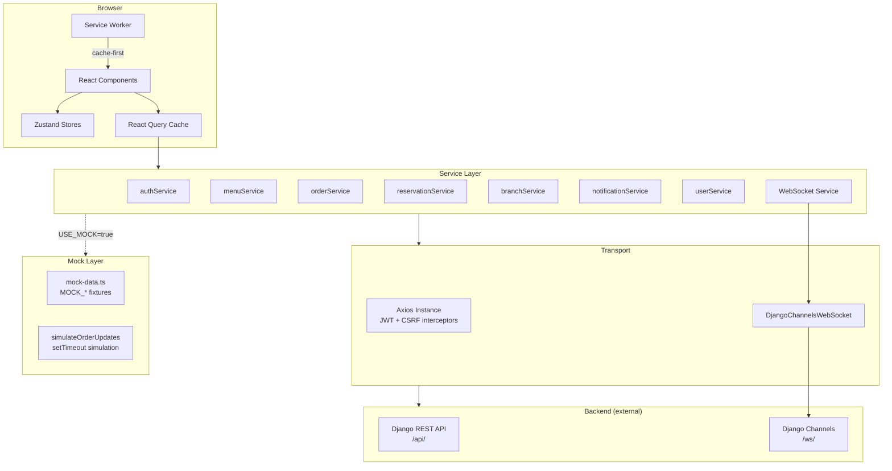
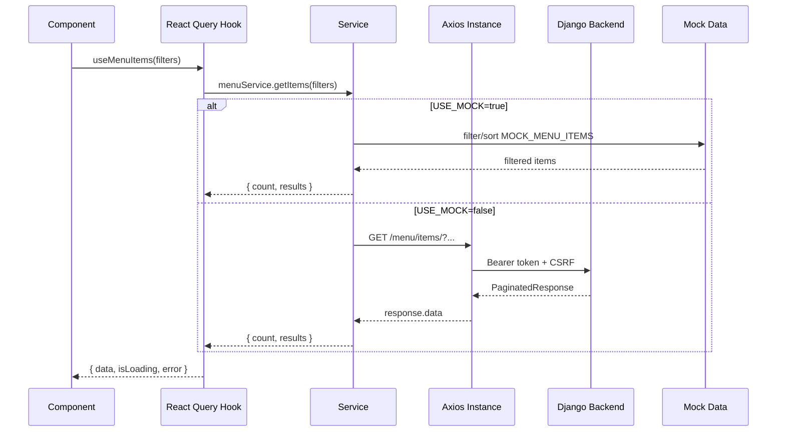
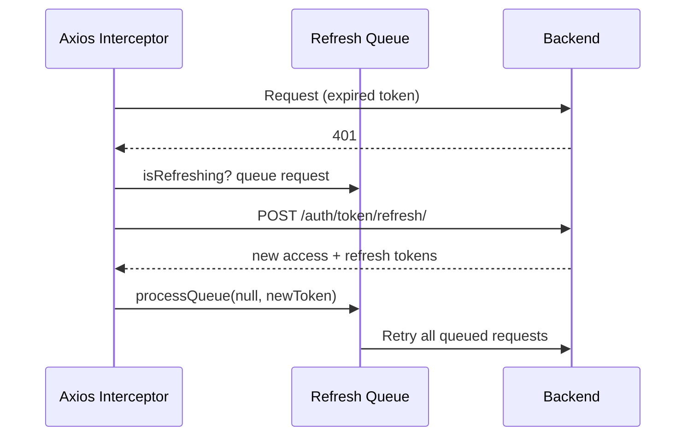
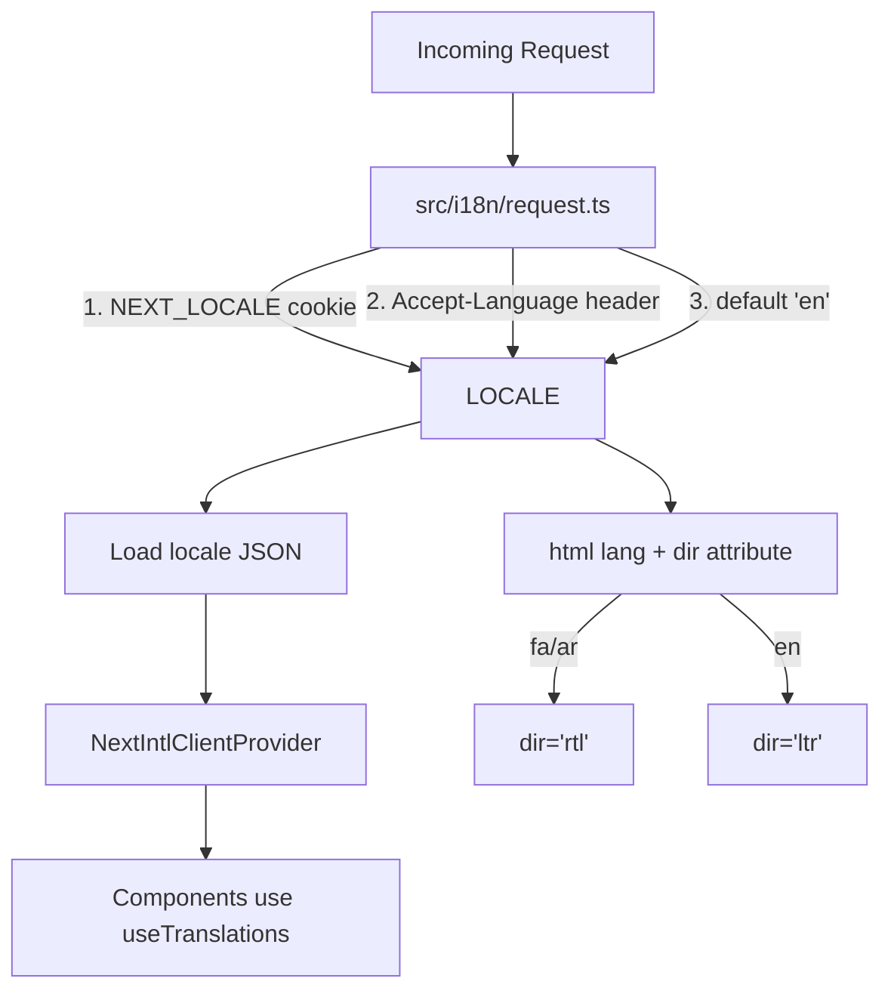
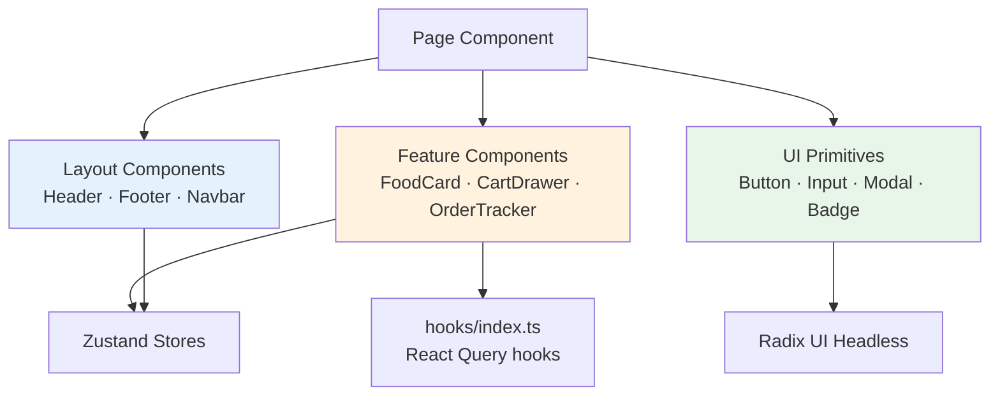

# Architecture — Samoon Frontend

> Comprehensive architecture documentation for the Samoon restaurant web application. All diagrams and descriptions are derived from actual source code analysis.

---

## Table of Contents

1. [System Overview](#system-overview)
2. [Architectural Style](#architectural-style)
3. [High-Level Architecture](#high-level-architecture)
4. [Frontend Architecture](#frontend-architecture)
5. [Module Boundaries](#module-boundaries)
6. [Folder Structure](#folder-structure)
7. [State Management Architecture](#state-management-architecture)
8. [API Layer Architecture](#api-layer-architecture)
9. [Localization Architecture](#localization-architecture)
10. [Realtime Architecture](#realtime-architecture)
11. [Routing Architecture](#routing-architecture)
12. [Component Architecture](#component-architecture)
13. [Build Architecture](#build-architecture)
14. [Deployment Architecture](#deployment-architecture)
15. [Key Design Decisions](#key-design-decisions)
16. [Architecture Weaknesses](#architecture-weaknesses)
17. [Scalability Limitations](#scalability-limitations)

---

## System Overview

Samoon is a **Next.js 15 App Router** frontend for a hospitality SaaS platform. The current codebase is deployed as a single-tenant restaurant application; the roadmap direction is toward a multi-tenant platform supporting multiple hospitality business types (restaurant, cafe, bar, hotel, and others) through a configurable Tenant / Location / Module architecture. See [ROADMAP.md](./ROADMAP.md) for the full platform direction and completion status.

The frontend communicates with a Django REST Framework + Django Channels backend over HTTPS (REST) and WSS (WebSocket). A built-in **mock mode** allows the entire application to run without a backend by returning simulated data with artificial delays.

```
┌─────────────────────────────────────────────────────────────────┐
│                        Browser (Client)                         │
│  Next.js 15 App Router + React 19 + Zustand + React Query       │
└────────────────────────────┬────────────────────────────────────┘
                             │ HTTP/HTTPS  │  WSS
                             ▼            ▼
┌────────────────────────────────────────────────────────────────┐
│                    Nginx Reverse Proxy                          │
│  Rate limiting · Static asset caching · SSL termination        │
└────┬───────────────────────────────────────────┬───────────────┘
     │ /  (Next.js)                             │ /api/ + /ws/ (Django)
     ▼                                          ▼
┌──────────────────┐                 ┌──────────────────────────┐
│  Next.js :3000   │                 │  Django + Channels :8000  │
│  (Docker)        │                 │  (External service)       │
└──────────────────┘                 └──────────────────────────┘
```

---

## Architectural Style

- **Rendering:** Hybrid — Server Components for layout/metadata/i18n; Client Components for all interactive UI
- **Data Fetching:** Client-side via TanStack React Query (no server-side `fetch` in RSC data patterns)
- **State:** Two-tier — Zustand (global UI/user state) + React Query (server cache)
- **API Mode:** Toggle between real backend and mock mode via environment variable
- **Real-time:** WebSocket via native `WebSocket` API wrapped in a custom class (not Socket.IO despite the package being installed)
- **Styling:** Tailwind CSS v4 with CSS custom properties for theming (no Tailwind config file — uses PostCSS plugin)

---

## High-Level Architecture



---

## Frontend Architecture

```mermaid
graph LR
    subgraph AppRouter["Next.js App Router (src/app/)"]
        LAYOUT[layout.tsx\nProviders + i18n]
        HOME[page.tsx\nLanding]
        MENU_PAGE[menu/page.tsx]
        CHECKOUT[checkout/page.tsx]
        DASH[dashboard/layout.tsx]
        ADMIN[admin/*]
        AUTH_PAGES[login / register / ...]
        TABLE[table/[tableId]]
        ORDER_PAGE[order/[orderId]]
    end

    subgraph Providers["src/providers/index.tsx"]
        QCP[QueryClientProvider]
        THEME_P[ThemeProvider]
        RTL_P[RTLProvider]
        AUTH_B[AuthBootstrapper]
        TOAST[Toaster]
    end

    subgraph Stores["src/stores/index.ts"]
        AUTH_S[useAuthStore]
        CART_S[useCartStore]
        THEME_S[useThemeStore]
        LANG_S[useLangStore]
        BRANCH_S[useBranchStore]
        NOTIF_S[useNotificationStore]
        FAV_S[useFavoritesStore]
        RECENT_S[useRecentlyViewedStore]
    end

    LAYOUT --> Providers
    Providers --> AppRouter
    AppRouter --> Stores
```

### Provider Bootstrap Sequence

On initial page load, `AuthBootstrapper` (mounted in `Providers`):

1. Reads `access_token` from `localStorage`
2. If present, calls `authService.getMe()` → sets `useAuthStore.user`
3. Simultaneously fetches `userService.getFavorites()` → hydrates `useFavoritesStore`
4. Listens for `auth:logout` custom DOM event (dispatched by Axios interceptor on unrecoverable 401)

`ThemeProvider` and `RTLProvider` apply CSS class / `dir` attribute changes reactively as their respective Zustand stores update.

---

## Module Boundaries

```
src/
├── app/           → Route segments (page, layout, error, not-found)
│                     Each page owns its own data-fetching via hooks
├── components/    → Reusable UI (no direct store access in primitives,
│                     store access allowed in feature components)
├── hooks/         → React Query hooks (index.ts, 162 exported hooks)
│                     + client utility hooks (client.ts)
│                     Bridge between services and components
├── modules/       → Module registry (registry.ts) + capability guard
│                     Defines 6 tenant business types and their nav/capabilities
├── services/      → Network layer — no React, no stores (30 service files)
│                     All mock branching lives here
├── stores/        → Zustand state — no network calls (11 stores)
├── providers/     → React context/provider setup + auth bootstrapping
├── lib/           → Static fixtures (mock-data.ts)
├── constants/     → App-wide constants (URLs, keys, rates)
├── types/         → TypeScript interfaces split across domain files
│                     index.ts, analytics.ts, audit-log.ts, branch.ts,
│                     notification.ts, provisioning.ts, qr-experience.ts,
│                     rbac.ts, realtime-operations.ts, staff.ts, etc.
├── utils/         → Pure functions (formatting, debounce, cn)
├── i18n/          → next-intl config + translation JSON
└── test/          → Vitest test files (59 files, 4,651 tests)
```

### Dependency Rules

```
app → hooks → services → axios.instance
app → components → hooks/stores
modules → stores/types
stores → types/constants
services → types/constants/mock-data
```

---

## Folder Structure

```
.
├── src/
│   ├── app/
│   │   ├── layout.tsx                  # Root layout + providers + i18n
│   │   ├── page.tsx                    # Home/landing page
│   │   ├── globals.css                 # Tailwind directives + CSS custom properties
│   │   ├── sitemap.ts                  # Dynamic sitemap generation
│   │   ├── error.tsx                   # Global error boundary
│   │   ├── not-found.tsx               # 404 page
│   │   ├── offline/page.tsx            # PWA offline fallback
│   │   ├── login/page.tsx
│   │   ├── register/page.tsx
│   │   ├── forgot-password/page.tsx
│   │   ├── verify-otp/page.tsx
│   │   ├── menu/page.tsx               # Full menu browser with filters
│   │   ├── restaurant/page.tsx         # About / restaurant info
│   │   ├── reservation/page.tsx        # Booking form
│   │   ├── reservation/confirm/page.tsx # Booking confirmation
│   │   ├── events/page.tsx             # Events listing
│   │   ├── location/page.tsx           # Location/map page
│   │   ├── loyalty/page.tsx            # Customer loyalty portal
│   │   ├── promotions/page.tsx         # Active promotions
│   │   ├── reviews/page.tsx            # Customer reviews
│   │   ├── vendors/page.tsx            # Vendor listing (food court)
│   │   ├── cart/page.tsx               # Redirect → /menu
│   │   ├── order/page.tsx              # Redirect → /dashboard/orders
│   │   ├── table/page.tsx              # Redirect → /menu
│   │   ├── checkout/
│   │   │   ├── page.tsx                # Multi-step checkout
│   │   │   ├── success/page.tsx        # Order confirmed + tracker
│   │   │   └── failure/page.tsx        # Payment failure
│   │   ├── order/[orderId]/page.tsx    # Order detail
│   │   ├── order/[orderId]/track/page.tsx  # Real-time order tracking subroute
│   │   ├── table/[tableId]/page.tsx    # QR dine-in entry
│   │   ├── dashboard/
│   │   │   ├── layout.tsx              # Sidebar layout
│   │   │   ├── page.tsx                # Overview
│   │   │   ├── orders/page.tsx
│   │   │   ├── reservations/page.tsx
│   │   │   ├── favorites/page.tsx
│   │   │   ├── addresses/page.tsx
│   │   │   └── settings/page.tsx
│   │   ├── admin/
│   │   │   ├── layout.tsx              # Admin shell with breadcrumbs
│   │   │   ├── analytics/page.tsx      # Menu + revenue analytics
│   │   │   ├── audit-logs/page.tsx     # Audit log browser
│   │   │   ├── audit-logs/[id]/page.tsx
│   │   │   ├── bar/events/page.tsx     # Bar module — events
│   │   │   ├── bar/happy-hour/page.tsx # Bar module — happy hour
│   │   │   ├── branches/page.tsx       # Branch management
│   │   │   ├── branches/[id]/page.tsx  # Branch detail
│   │   │   ├── branches/[id]/analytics/page.tsx
│   │   │   ├── branches/analytics/page.tsx
│   │   │   ├── cafe/happy-hour/page.tsx
│   │   │   ├── cafe/loyalty/page.tsx
│   │   │   ├── customers/page.tsx      # Customer list with bulk ops
│   │   │   ├── customers/[id]/page.tsx # Customer detail
│   │   │   ├── customers/[id]/reviews/page.tsx
│   │   │   ├── food-court/seating/page.tsx
│   │   │   ├── food-court/vendors/page.tsx
│   │   │   ├── food-truck/routes/page.tsx
│   │   │   ├── food-truck/stops/page.tsx
│   │   │   ├── kitchen/page.tsx        # Kitchen display (KitchenDisplay component)
│   │   │   ├── loyalty/page.tsx        # Loyalty program management
│   │   │   ├── menu/page.tsx           # Menu management
│   │   │   ├── mobile-cafe/loyalty/page.tsx
│   │   │   ├── mobile-cafe/routes/page.tsx
│   │   │   ├── notifications/page.tsx  # Notification center
│   │   │   ├── notifications/[id]/page.tsx
│   │   │   ├── operations/page.tsx     # Realtime ops dashboard
│   │   │   ├── orders/page.tsx         # Order board with bulk ops
│   │   │   ├── orders/[id]/page.tsx    # Order detail
│   │   │   ├── promotions/page.tsx     # Promotion management
│   │   │   ├── promotions/[id]/page.tsx
│   │   │   ├── reservations/page.tsx   # Reservation management with bulk ops
│   │   │   ├── reservations/[id]/page.tsx
│   │   │   ├── settings/page.tsx       # Settings with persistence
│   │   │   ├── settings/feature-flags/page.tsx
│   │   │   ├── staff/page.tsx          # Staff management
│   │   │   ├── staff/[id]/page.tsx     # Staff detail
│   │   │   ├── tenants/page.tsx        # Tenant management
│   │   │   ├── tenants/new/page.tsx
│   │   │   ├── tenants/[slug]/page.tsx
│   │   │   ├── vendors/page.tsx        # Vendor management
│   │   │   └── vendors/[id]/page.tsx
│   │   └── api/health/route.ts         # Health check endpoint
│   ├── components/
│   │   ├── layout/                     # Header, Navbar, Footer, MainLayout
│   │   ├── menu/                       # FoodCard, FoodDetailModal
│   │   ├── cart/                       # CartDrawer, FloatingCart
│   │   ├── order/                      # OrderTracker
│   │   ├── notification/               # NotificationCenter
│   │   ├── auth/                       # AuthGuard, PermissionGuard
│   │   ├── guards/                     # AuthGuard wrappers
│   │   ├── charts/                     # Chart primitives for analytics
│   │   ├── pwa/                        # PWA install prompt
│   │   ├── common/                     # BranchSelector, PageTransition, JsonLd, ErrorBoundary
│   │   ├── admin/                      # Admin-specific components:
│   │   │   ├── ActivityFeed.tsx
│   │   │   ├── AdminBreadcrumbs.tsx
│   │   │   ├── AnalyticsExport.tsx
│   │   │   ├── AuditTimeline.tsx
│   │   │   ├── BranchStatusGrid.tsx
│   │   │   ├── BulkActionBar.tsx
│   │   │   ├── KitchenDisplay.tsx
│   │   │   ├── LiveOrderQueue.tsx
│   │   │   ├── LiveReservationQueue.tsx
│   │   │   ├── PushNotificationSettings.tsx
│   │   │   ├── RealtimeDashboardWidgets.tsx
│   │   │   ├── SLAMonitor.tsx
│   │   │   └── StaffPresenceBoard.tsx
│   │   └── ui/                         # Button, Input, Modal, Badge, Card, Avatar, ...
│   ├── hooks/
│   │   ├── index.ts                    # 162 React Query hooks (auth, menu, order, admin, etc.)
│   │   └── client.ts                   # WebSocket hooks + utility hooks
│   ├── modules/
│   │   ├── registry.ts                 # 6 tenant module types + nav/capability definitions
│   │   └── capability-guard.ts         # Runtime capability enforcement
│   ├── services/                       # 30 service files — all mock-gated
│   │   ├── axios.instance.ts           # Axios + JWT/CSRF interceptors + refresh logic
│   │   ├── endpoints.ts                # All API endpoint constants
│   │   ├── admin.service.ts            # Admin CRUD operations
│   │   ├── analytics.service.ts        # Menu + revenue analytics
│   │   ├── audit-log.service.ts        # Audit log queries
│   │   ├── audit-event-registry.ts     # Audit event type definitions
│   │   ├── auth.service.ts             # Authentication methods
│   │   ├── branch.service.ts           # Branch management
│   │   ├── branch-access.service.ts    # Branch-scoped access control
│   │   ├── branch-analytics.service.ts # Per-branch analytics
│   │   ├── combined.service.ts         # reservation, notification, user (legacy)
│   │   ├── feature-flags.service.ts    # Feature flag CRUD
│   │   ├── loyalty.service.ts          # Loyalty points + rewards
│   │   ├── menu.service.ts             # Menu data methods
│   │   ├── notification.service.ts     # Notification delivery
│   │   ├── notification-event-registry.ts
│   │   ├── notification-preferences.service.ts
│   │   ├── order.service.ts            # Order CRUD
│   │   ├── order-routing.service.ts    # Multi-branch order routing
│   │   ├── payment.service.ts          # Payment (mock only)
│   │   ├── permission.service.ts       # Permission resolution
│   │   ├── promotion.service.ts        # Promotion management
│   │   ├── qr-experience.service.ts    # QR table/ordering experience
│   │   ├── rbac.service.ts             # Role-based access control
│   │   ├── realtime-event-registry.ts  # Real-time event type definitions
│   │   ├── realtime-operations.service.ts # Kitchen + SLA operations
│   │   ├── review.service.ts           # Customer reviews
│   │   ├── staff.service.ts            # Staff management
│   │   ├── tenant.service.ts           # Tenant CRUD
│   │   ├── tenant-provisioning.service.ts # Tenant onboarding
│   │   ├── vendor.service.ts           # Food court vendor management
│   │   └── websocket.service.ts        # WebSocket class + mock simulation
│   ├── stores/index.ts                 # 11 Zustand stores
│   ├── providers/index.tsx             # QueryClient + Theme + RTL + Auth bootstrap
│   ├── lib/mock-data.ts                # All mock fixtures
│   ├── constants/index.ts              # App constants
│   ├── types/                          # TypeScript types (no runtime code)
│   │   ├── index.ts                    # Core types
│   │   ├── analytics.ts                # MenuAnalytics, RevenueAnalytics, etc.
│   │   ├── audit-log.ts                # AuditLog, AuditEventType
│   │   ├── branch-routing.ts           # BranchRoutingRule, etc.
│   │   ├── branch.ts                   # Branch, BranchCapability
│   │   ├── notification.ts             # Notification, NotificationPreferences
│   │   ├── provisioning.ts             # TenantProvisioning types
│   │   ├── qr-experience.ts            # QRSession, QRExperienceType
│   │   ├── rbac.ts                     # P7Permission, Role, RbacPolicy
│   │   ├── realtime-operations.ts      # LiveOrder, KitchenStatus, SLABreach
│   │   └── staff.ts                    # StaffMember, Shift, etc.
│   ├── utils/index.ts                  # Pure utility functions
│   ├── i18n/
│   │   ├── request.ts                  # next-intl locale detection
│   │   └── locales/                    # en.json, fa.json, ar.json (ar partial)
│   └── test/
│       ├── setup.ts
│       └── *.test.ts                   # 59 test files, 4,651 tests
├── public/
│   ├── sw.js                           # Service worker (cache-first static, network-first API)
│   ├── firebase-messaging-sw.js        # Firebase push notification handler
│   ├── manifest.json                   # PWA manifest (shortcuts, icons, theme)
│   ├── og-image.jpg                    # Open Graph image
│   ├── icons/                          # PWA icons (72px–512px)
│   └── robots.txt
├── next.config.ts                      # Next.js + next-intl config
├── tsconfig.json                       # TypeScript config (paths: @/)
├── eslint.config.mjs                   # ESLint (Next.js defaults)
├── postcss.config.mjs                  # @tailwindcss/postcss
├── Dockerfile                          # Multi-stage Docker build
├── docker-compose.yml                  # Production stack
├── docker-compose.dev.yml              # Development stack
├── nginx.conf                          # Production Nginx config
└── .env.example                        # Environment variable documentation
```

---

## State Management Architecture

```mermaid
graph TD
    subgraph Persisted["Persisted (localStorage)"]
        CART[useCartStore\nitems · discount · isOpen]
        THEME[useThemeStore\ntheme: light|dark|system]
        LANG[useLangStore\nlocale: en|fa|ar]
        BRANCH[useBranchStore\nactiveBranch]
        FAV[useFavoritesStore\nfavorites: Set<string>]
        RECENT[useRecentlyViewedStore\nitems: MenuItem[]]
        TENANT[useTenantStore\ntenant · activeModule]
        DINEIN[useDineInStore\ntableNumber · sessionId]
    end

    subgraph InMemory["In-Memory Only"]
        AUTH[useAuthStore\nuser · isAuthenticated · isLoading]
        NOTIF[useNotificationStore\nnotifications · unreadCount]
        RBAC[useRbacStore\npermissions · role · policies]
    end

    subgraph ReactQuery["React Query (server cache)"]
        MENU_Q[menu-items · categories]
        ORDER_Q[orders · order detail]
        RES_Q[reservations]
        BRANCH_Q[branches]
        NOTIF_Q[notifications — polls 60s]
        USER_Q[addresses · favorites]
    end

    AUTH -->|hydrated on mount| AuthBootstrapper
    FAV -->|synced from server| ReactQuery
    NOTIF -->|updated by| NOTIF_Q
    CART -->|cleared on| ORDER_Q
```

### Cart Total Computation

Cart totals are computed as **derived state** via getter functions, not stored:

```
subtotal = sum(item.unit_price * item.quantity)
tax      = subtotal × TAX_RATE (0.09)
service  = subtotal × SERVICE_CHARGE_RATE (0.05)
total    = subtotal - discountAmount + tax + service
```

Constants `TAX_RATE` and `SERVICE_CHARGE_RATE` are hardcoded in `src/constants/index.ts`.

---

## API Layer Architecture



### Token Refresh Flow



---

## Localization Architecture



**Font strategy:**
- Latin scripts: DM Sans (body) + Playfair Display (display/headings)
- Arabic/Persian: Vazirmatn loaded unconditionally in `layout.tsx`

**Locale switching:** The `useLangStore.setLocale()` action sets `document.documentElement.lang` and `dir` immediately (client-side), but the Next.js locale is read server-side from the cookie. A page reload is required for server-rendered translations to update.

---

## Realtime Architecture

```mermaid
graph LR
    subgraph Implemented["Implemented"]
        WS_SVC[DjangoChannelsWebSocket\nwebsocket.service.ts]
        OWS[orderWebSocket singleton]
        NWS[notificationWebSocket singleton]
        HOOK_O[useOrderWebSocket\nhooks/client.ts]
        HOOK_N[useNotificationWebSocket\nhooks/client.ts]
    end

    subgraph Mock["Mock Simulation (active)"]
        SIM[simulateOrderUpdates\nsetTimeout sequence]
        TRACKER[OrderTracker.tsx\nuseMockSimulation=true]
    end

    subgraph Connected["Wired to UI"]
        HOOK_O -->|mounted by| TRACKER[OrderTracker.tsx\norder/[orderId]/track]
        HOOK_N -->|mounted by| NOTIF_CENTER[NotificationCenter]
        KWS[useKitchenStatus] -->|mounted by| KITCHEN[admin/kitchen/page.tsx]
        RWS[useRealtimeOperations] -->|mounted by| OPS[admin/operations/page.tsx]
    end

    WS_SVC --> OWS
    WS_SVC --> NWS
    OWS --> HOOK_O
    NWS --> HOOK_N
    SIM --> TRACKER
```

**Current state:** WebSocket infrastructure is wired to the UI. `OrderTracker` uses `useOrderWebSocket` (with `simulateOrderUpdates` fallback in mock mode). Kitchen display and realtime operations use `useKitchenStatus` and `useRealtimeOperations` hooks connected to WebSocket channels. Notification WebSocket is mounted for authenticated users.

---

## Routing Architecture

```mermaid
graph TD
    ROOT[/ Root Layout\nsrc/app/layout.tsx]
    ROOT --> HOME[/ Home]
    ROOT --> MENU[/menu]
    ROOT --> RESTO[/restaurant]
    ROOT --> RES[/reservation /reservation/confirm]
    ROOT --> TABLE[/table /table/tableId]
    ROOT --> CO[/checkout /checkout/success /checkout/failure]
    ROOT --> ORDER[/order/orderId /order/orderId/track]
    ROOT --> PUBS[Public pages\n/events /location /loyalty\n/promotions /reviews /vendors]
    ROOT --> AUTH[Auth Routes\n/login /register\n/forgot-password /verify-otp]
    ROOT --> DASH[/dashboard\nsrc/app/dashboard/layout.tsx]
    ROOT --> ADMIN[/console/* — 40+ routes\nPermissionGuard on each page]
    ROOT --> API[/api/health]
    ROOT --> OFFLINE[/offline — PWA fallback]

    DASH --> DASH_HOME[/dashboard]
    DASH --> ORDERS[/dashboard/orders]
    DASH --> RESERV[/dashboard/reservations]
    DASH --> FAV[/dashboard/favorites]
    DASH --> ADDR[/dashboard/addresses]
    DASH --> SETT[/dashboard/settings]
```

**Route protection status:**
- Customer dashboard and checkout: protected via `AuthGuard` client component
- Admin routes: protected via `PermissionGuard` with `P7Permission` strings on every page
- No Next.js `middleware.ts` (server-side route protection is a remaining gap)
- Dead routes (`/cart`, `/order`, `/table`) redirect to canonical destinations

---

## Component Architecture



### UI Primitive Layer

Built on **Radix UI** headless components with custom Tailwind styling. Key primitives:

- `Button` — variants: default/secondary/outline/ghost/destructive, sizes: sm/md/lg/icon
- `Input` — with label, error, icon slots
- `Modal` — Radix Dialog with custom styling
- `Badge` — variants: default/secondary/success/warning/danger/info/purple
- `Card` — semantic container
- `Avatar`, `Skeleton`, `Divider`, `FoodCardSkeleton`

---

## Build Architecture

```mermaid
graph LR
    TS[TypeScript\nsrc/**/*.ts(x)] --> SWC[SWC Compiler]
    CSS[globals.css\nTailwind v4] --> POSTCSS[@tailwindcss/postcss]
    SWC --> NEXT[Next.js Build]
    POSTCSS --> NEXT
    NEXT -->|output: standalone| SA[.next/standalone/]
    SA --> DOCKER[Docker Runner\nnode server.js]
```

**Build configuration (`next.config.ts`):**
- `output: "standalone"` — self-contained deployment artifact
- `optimizeCss: true` — uses `critters` for critical CSS inlining
- Image domains: `images.unsplash.com`, `res.cloudinary.com`, `*.amazonaws.com`, `localhost`
- Security headers applied to all routes
- `next-intl` plugin wraps the config

**TypeScript:** Path alias `@/` maps to `src/`. Strict mode is enabled.

---

## Deployment Architecture

```
┌─────────────────────────────────────────────────────────────────┐
│                         Docker Host                             │
│                                                                 │
│  ┌──────────────────────┐    ┌──────────────────────────────┐   │
│  │    samoon-nginx       │    │        samoon-app             │   │
│  │  (nginx:alpine)      │    │  (node:22-alpine)            │   │
│  │  ports: 80, 443      │    │  port: 3000 (internal)       │   │
│  │  ./nginx.conf        │    │  NODE_ENV=production         │   │
│  │  cache: nginx-cache  │    │  user: nextjs (uid 1001)     │   │
│  └──────────┬───────────┘    └──────────────────────────────┘   │
│             │ samoon-net                                          │
│  ┌──────────┴──────────────────────────────────────────────┐    │
│  │                   shared-net (external)                  │    │
│  │              Django backend service lives here           │    │
│  └─────────────────────────────────────────────────────────┘    │
│                                                                  │
│  Volumes:                                                        │
│    nginx-cache         (internal)                               │
│    backend_static_volume (external — created by Django service) │
└─────────────────────────────────────────────────────────────────┘
```

**Network topology:**
- `samoon-net` — internal bridge for Next.js ↔ Nginx
- `shared-net` — external bridge shared with Django backend service
- `static_volume` — external volume mounted from the Django container, served by Nginx at `/static/`

---

## Key Design Decisions

### 1. Mock Mode as a First-Class Feature

Every service method has a dual code path: real API or mock. This is controlled by `NEXT_PUBLIC_USE_MOCK`. The mock path returns rich, realistic data with artificial delays. This decision enables:
- Frontend development without a running backend
- Demo deployments
- **Risk:** Production deployment with mock mode accidentally left on

### 2. Zustand + React Query Separation

Global UI state (cart, theme, auth user) lives in Zustand. Server-sourced data (menu items, orders, reservations) lives in React Query. The two are bridged in hooks (e.g., `useNotifications` updates the Zustand notification store from the React Query response).

### 3. CSS Custom Properties for Theming

Instead of Tailwind dark mode classes on every element, the app uses CSS variables (`--bg`, `--fg`, `--card`, `--border`, etc.) that change their values based on the `dark` class on `<html>`. This keeps component markup clean but means the design system lives entirely in `globals.css`.

### 4. Logical CSS Properties for RTL

All directional CSS uses Tailwind logical property classes (`ps-`, `pe-`, `ms-`, `me-`, `start-`, `end-`) instead of `pl-`, `pr-`, `ml-`, `mr-`, `left-`, `right-`. This means RTL layout works automatically when `dir="rtl"` is set.

### 5. Hand-Written Service Worker

Despite `next-pwa` being listed as a dependency, the service worker is a hand-written `public/sw.js`. This gives full control but means `next-pwa`'s versioning, injection, and Workbox features are unused.

### 6. JWT in localStorage (Security Trade-off)

Tokens are stored in `localStorage` for simplicity. This is vulnerable to XSS. The mitigating factors are: strict CSP (not yet implemented) and the security headers (`X-XSS-Protection`, `X-Content-Type-Options`). The alternative (httpOnly cookies) would require backend coordination.

### 7. DjangoChannelsWebSocket vs Socket.IO

Despite `socket.io-client` being installed, all WebSocket code uses the native `WebSocket` browser API wrapped in a custom class. This is correct for Django Channels (which uses native WebSocket protocol) but makes the Socket.IO dependency dead code.

---

## Architecture Weaknesses

| Weakness | Description | Severity | Status |
|----------|-------------|----------|--------|
| No route authentication middleware | Missing `src/middleware.ts`; admin/dashboard protected by client-side guards only | Critical | Open |
| No real backend integration | All services run against mock data; no Django backend deployed | Critical | Open (backend dependency) |
| No CI pipeline | No quality gates (lint, type-check, test, build) — regressions are not caught before merge | High | Open |
| Incomplete Arabic locale | `ar.json` has 14/187 keys | High | Open |
| Firebase not fully initialized | VAPID key is placeholder; push notifications won't fire in production | High | Open |
| No payment gateway | Checkout flow is UI-only; no Stripe/PayPal integration | High | Open |
| Combined service file | `combined.service.ts` still mixes reservation, notification, and user services | Medium | Open |
| Hardcoded TAX_RATE / SERVICE_CHARGE | Cannot vary by region or tenant without code change | Medium | Open |
| JWT in localStorage | XSS risk; httpOnly cookies require backend coordination | Medium | Open |
| No Sentry initialization | `NEXT_PUBLIC_SENTRY_DSN` documented but `@sentry/nextjs` not installed | Medium | Open |
| ~~No Tenant/Location/Module abstraction~~ | ~~No concept of Tenant, Location, or Module~~ | ~~Critical~~ | ✅ Resolved (P1A–P2) |
| ~~Admin has no real backend~~ | ~~All admin pages use hardcoded fixtures~~ | ~~Critical~~ | ✅ Resolved (P5–P7) — mock-gated service layer |
| ~~No design token system~~ | ~~CSS custom properties were ad-hoc~~ | ~~High~~ | ✅ Resolved (P2) — structured CSS variable system |
| ~~WebSocket hooks never mounted~~ | ~~Real-time infrastructure built but not activated~~ | ~~High~~ | ✅ Resolved (P7.7–P7.8) |
| ~~No error boundaries~~ | ~~Only global error.tsx existed~~ | ~~High~~ | ✅ Resolved (P3 + P7) — ErrorBoundary on every admin page |
| ~~No RBAC~~ | ~~Any authenticated user could access admin~~ | ~~Critical~~ | ✅ Resolved (P1B + P7) — PermissionGuard + useRbacStore |
| ~~Module registry missing~~ | ~~No mechanism to register business-type capabilities~~ | ~~Critical~~ | ✅ Resolved (P1A) — src/modules/registry.ts |
| ~~socket.io-client unused~~ | ~~Installed but WebSocket uses native API~~ | ~~Low~~ | ✅ Resolved — removed |
| ~~next-pwa unused~~ | ~~Installed but not configured~~ | ~~Low~~ | ✅ Resolved — removed |

---

## Scalability Limitations

| Limitation | Impact | Mitigation Path |
|------------|--------|-----------------|
| Single-tenant data model | All services and types assume one restaurant; adding a second tenant requires invasive changes across every service, type, and API call | Introduce `Tenant` and `Location` models per Phase 1A |
| No module registry | Business-type capabilities (cafe, bar, hotel) cannot be added without modifying core routing, navigation, and shared components | Introduce Module Registry per Phase 1A |
| Single Django backend in Nginx config | No horizontal scaling for API | Add upstream load balancing in Nginx |
| No CDN for static assets | Cold Nginx cache = slow first load | Add CloudFront/Cloudflare in front |
| Cart in localStorage | Multi-device cart sync unsupported | Sync cart to backend on auth |
| Favorites as `Set<string>` (serialized) | localStorage size limit at scale | Server-side favorites list |
| No pagination in admin pages | Performance degradation at scale | Implement API-backed admin |
| React Query polls notifications 60s | N active users = N requests/min | Replace with WebSocket push |
| Hardcoded TAX_RATE/SERVICE_CHARGE | Can't support multi-region taxes | Move to backend configuration |
| Single locale file per language | No namespace splitting / lazy loading | Split into feature-level bundles |
