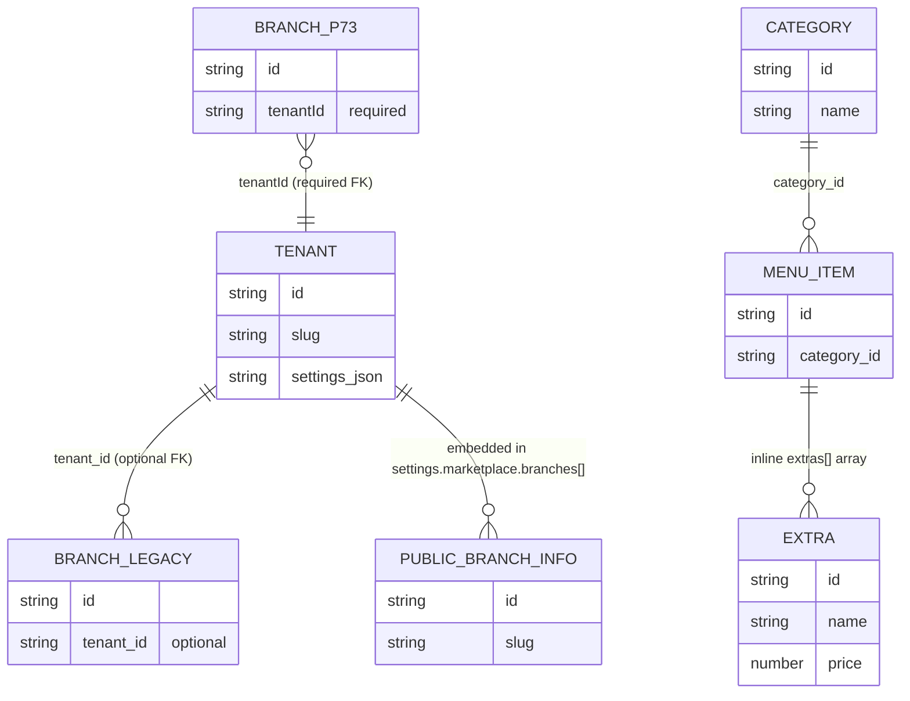

# Menu ↔ Tenant ↔ Branch Architecture Analysis

## Executive Summary

This repository (`samoon_Q`) is a **Next.js 15 (App Router) frontend only** — TypeScript, React Query, Zustand, Axios. A repo-wide search confirms **there are no `.py` files, no Django project, no ORM models, no serializers, and no viewsets in this codebase**. The Django backend that this frontend talks to (referenced only in documentation, e.g. `docs/ARCHITECTURE.md:466` — `participant B as Django Backend`) is an **external service reached over HTTP**; its source is not present here and therefore cannot be inspected. Every statement below about the backend's real behavior is inferred only from what the frontend actually sends (URLs, headers, payloads) — not from backend source, which does not exist in this repo.

Given that constraint, the key, code-provable finding is:

- **There is no `Menu` entity anywhere in the type system, and no tenant/branch foreign key on `Category` or `MenuItem`.** The "menu" is an unscoped, flat collection returned by two global endpoints (`/menu/categories/`, `/menu/items/`). No request the frontend makes to these endpoints carries a `tenantId` or `branchId`. Tenant/branch scoping, if it exists at all, is therefore delegated entirely to the (uninspectable) backend's own session/JWT resolution — the client provides no tenant or branch discriminator on menu calls.
- Two structurally different, colliding TypeScript types are both named `Branch` (`src/types/index.ts` vs `src/types/branch.ts`), and a third, ad-hoc "branch" representation is nested inside `Tenant.settings.marketplace.branches[]`.

## Domain Model

All types live in `/home/user/samoon_Q/src/types/`. There is no backend model source in this repo; these are the client-side contracts the frontend assumes.

### Tenant — `src/types/index.ts:316-348`
```ts
export interface Tenant {
  id: string
  name: string
  slug: string
  businessTypes: string[]
  status: TenantStatus
  createdAt: string
  settings?: Record<string, unknown>   // marketplace/branches/theme/featureFlags nested here
  ownerId?: string
}
```
No `menuId`/`menuIds` field. A `Tenant` does not reference a `Menu` at the type level.

### Branch / Location — two incompatible definitions share the exported name `Branch`

**Legacy model**, `src/types/index.ts:374-396`:
```ts
export interface Location {
  id: string
  tenant_id?: string
  name: string
  slug: string
  type?: LocationType
  address: string
  city: string
  phone_number: string
  ...
}
export type Branch = Location
```
Optional `tenant_id` (snake_case), used by `combined.service.ts` / mock data.

**P7.3 admin model**, `src/types/branch.ts:51-66`:
```ts
export interface Branch {
  id: string
  tenantId: string   // required FK to Tenant
  name: string
  slug: string
  status: BranchStatus
  type: BranchType
  location: BranchLocation
  ...
}
```
`branch.service.ts:8-9` documents the split explicitly: "The old branchService in combined.service.ts uses the legacy Location/Branch type. This service uses the new P7.3 Branch domain model from types/branch.ts." Neither `Branch` type has a `menuId` field.

**Third representation**: `PublicBranchInfo` (`src/types/marketplace.ts`) is read out of `Tenant.settings.marketplace.branches[]` — an ad-hoc array embedded in the Tenant's `settings` blob, consumed by `usePublicBranch()` (`src/hooks/index.ts:1953-1965`), not by either `Branch` type or `branch.service.ts`.

### Menu — does not exist as a type
A repo-wide search of `src/types` finds no top-level `Menu` interface/type. There is no menu id, no menu-to-branch or menu-to-tenant join anywhere in the type system. "The menu" is implicitly the full set of `Category` + `MenuItem` records returned by two flat, unscoped endpoints.

### Category — `src/types/index.ts:69-78`
```ts
export interface Category {
  id: string
  name: string
  slug: string
  description?: string
  image?: string
  icon?: string
  order: number
  items_count?: number
}
```
No `tenant_id`, `branch_id`, or `menu_id`.

### MenuItem — `src/types/index.ts:87-111`
```ts
export interface MenuItem {
  id: string
  category_id: string
  category?: Category
  name: string
  slug: string
  ...
  extras?: Extra[]
  ...
}
```
Links only to `Category` via `category_id`. No `tenant_id`, `branch_id`, or `menu_id`.

### Extra — `src/types/index.ts:80-85`
```ts
export interface Extra {
  id: string
  name: string
  price: number
  available: boolean
}
```
No tenant/branch/menu linkage. `Extra`s are nested inline under `MenuItem.extras`, not fetched or scoped independently.

### Relationships as they exist in code
- `MenuItem` → `Category` (via `category_id`) — the only real FK-like relationship in the menu domain.
- `Category` / `MenuItem` → **nothing** at the Tenant or Branch level.
- `Tenant` → `Branch` (legacy) via `Location.tenant_id` (optional) — the only tenant/branch link that exists, and it lives on the Branch/Location side, not on any menu type.
- `Tenant` → `PublicBranchInfo[]` via the embedded `settings.marketplace.branches` array (a third, parallel branch representation).

## Backend Analysis

**No Django (or any other) backend source exists in this repository.** A full search for `*.py`, `models.py`, `serializers.py`, `views.py`, `urls.py` returns zero results. Consequently the requested items — Django models, ForeignKey/OneToOne/ManyToMany fields, `Meta` constraints, managers, querysets, serializers, viewsets, services — **cannot be documented from this codebase because the code does not exist here.** The backend is referenced only as an external HTTP service (see `docs/ARCHITECTURE.md:466`, and the URL map in `src/services/endpoints.ts`).

The only backend-adjacent facts provable from this repo are about what the **client sends and expects**, covered under API Analysis below.

Direct answers to the assignment's specific questions, based only on what is provable:

- **Is a Menu attached directly to a Tenant?** Not provable — no `Menu` type exists, and no menu-fetching call includes a tenant identifier in its body/params. Cannot be confirmed or denied from backend source (absent).
- **Is a Menu attached to a Branch?** Same — no `branch_id`/`branchId` appears anywhere in `menu.service.ts` or `endpoints.ts`.
- **Can multiple branches share one menu?** Not answerable from this repo; there is no join table, and no branch discriminator is ever sent, so from the client's perspective every branch under a tenant would receive the identical, unscoped `/menu/categories/` and `/menu/items/` responses.
- **Can a tenant own multiple menus?** No — there is no `Menu` id/entity for a tenant to own multiple of.
- **Can a branch have multiple menus?** No — same reason.
- **Where is this enforced?** Nowhere in this repository. If tenant/branch scoping happens at all, it happens exclusively inside the external Django backend using signals not passed by the client (e.g., a session or JWT-derived tenant), which this repo cannot corroborate.

## API Analysis

Source: `/home/user/samoon_Q/src/services/endpoints.ts:17-27` (menu), `:58-70` (branches), `:94-105` (tenants); implementation in `/home/user/samoon_Q/src/services/menu.service.ts`.

```ts
MENU: {
  CATEGORIES: '/menu/categories/',
  CATEGORY: (id: string) => `/menu/categories/${id}/`,
  ITEMS: '/menu/items/',
  ITEM: (id: string) => `/menu/items/${id}/`,
  ITEM_BY_SLUG: (slug: string) => `/menu/items/${slug}/`,
  FEATURED: '/menu/items/featured/',
  POPULAR: '/menu/items/popular/',
  SEARCH: '/menu/items/search/',
  RELATED: (id: string) => `/menu/items/${id}/related/`,
},
```

| Endpoint | Method | Tenant/Branch carried? |
|---|---|---|
| `/menu/categories/` | GET | No — `menuService.getCategories()` (`menu.service.ts`) takes no args |
| `/menu/categories/{id}/` | GET | No |
| `/menu/items/` | GET | No — `MenuFilters` only supports `category, search, min_price, max_price, min_rating, available, sort, page, page_size` (`menu.service.ts:9-19`) |
| `/menu/items/{id}/` | GET | No |
| `/menu/items/{slug}/` | GET | No |
| `/menu/items/featured/` | GET | No |
| `/menu/items/popular/` | GET | No |
| `/menu/items/search/` | GET | No |
| `/menu/items/{id}/related/` | GET | No |
| `/menu/items/` (create) | POST | No — `formToPayload()` in `src/app/console/menu/page.tsx:59-73` never includes a tenant or branch field |
| `/menu/items/{id}/` (update) | PATCH | No |
| `/menu/items/{id}/` (delete) | DELETE | No |

**How tenant/branch is determined per request:** it isn't, at the request-parameter level. The only tenant/branch signal that leaves the browser at all is the `Authorization: Bearer <token>` header and a CSRF header, attached generically to every request by the Axios interceptor (`src/services/axios.instance.ts:58-75`) — no `X-Tenant-Slug` or `X-Branch-Slug` header is set on outgoing API calls. `src/middleware.ts:78-107` does set an `x-tenant-slug` header, but only on the **Next.js server-rendered page request**, not on the client-side Axios calls to the backend.

**Filtering logic:** entirely client-side/in-memory. Components fetch the full `useMenuItems()`/`useCategories()` result sets once and filter/map them locally (e.g. `src/app/[tenantSlug]/[branchSlug]/BranchHomepageClient.tsx:702-703`), rather than the backend being asked to filter by tenant/branch.

**Permissions:** not inspectable — permission enforcement, if any, happens inside the external backend. The frontend applies only its own RBAC/route guards (documented separately under `docs/P8.5_RBAC_AUDIT.md` etc.), unrelated to menu tenant/branch scoping.

## Frontend Analysis

- **Menu API client:** `/home/user/samoon_Q/src/services/menu.service.ts` — `getCategories()`, `getItems(filters)`, `getItem(id)`, `getFeatured()`, `getPopular()`, `getRelated(id)`, `search(query)`, `createItem/updateItem/deleteItem`. None accept tenant or branch identifiers.
- **React Query hooks:** `/home/user/samoon_Q/src/hooks/index.ts:612-667` (reads: `useCategories`, `useMenuItems`, `useFeaturedItems`, `useRelatedItems`, `useMenuSearch`), `:1565-1600` and `:1833+` (mutations: `useCreateMenuItem`, `useUpdateMenuItem`, `useDeleteMenuItem`).

  Example — tenant is read from the store only to key the cache, not sent to the server:
  ```ts
  // src/hooks/index.ts:612-620
  export function useCategories() {
    const tenantId = useTenantStore((s) => s.tenant?.id)
    return useQuery({
      queryKey: ['categories', tenantId],          // cache partition only
      queryFn: () => menuService.getCategories(),  // no tenantId passed to the call
      ...
    })
  }
  ```
  Branch is never referenced in any menu query key or call.

- **Tenant store (Zustand, persisted):** `useTenantStore`, `/home/user/samoon_Q/src/stores/index.ts:223-312` — holds `tenant: Tenant`, populated via `loadTenant(slug)` → `tenantService.getTenant(slug)`.
- **Branch store (Zustand, persisted):** `useBranchStore`, `/home/user/samoon_Q/src/stores/index.ts:315-335` — holds `activeBranch: Branch | null` (public) and `adminActiveBranch: AdminBranch | null` (admin).
- **tenantId/branchId resolution paths found:**
  1. **URL route params** — `src/app/[tenantSlug]/[branchSlug]/menu/page.tsx` receives `tenantSlug`/`branchSlug` as Next.js dynamic segments, but does not thread them as props into `<MenuContent/>`.
  2. **Middleware header** — `src/middleware.ts:26-42,78-107` resolves the tenant slug from subdomain (prod) or `NEXT_PUBLIC_TENANT_SLUG` (dev) and injects `x-tenant-slug` — but only for server-rendered page requests, not for client Axios calls.
  3. **Zustand stores** — the actual runtime source components read from, e.g. `MenuContent.tsx:65-66`: `useTenantStore((s) => s.tenant?.name)`, `useBranchStore((s) => s.activeBranch?.name)` — used only to render display text (page headings), not to parameterize menu fetches.
  4. **`usePublicBranch(tenantSlug, branchSlug)`** (`src/hooks/index.ts:1953-1965`) resolves branch data not via `branch.service.ts`, but by fetching the Tenant and reading the embedded `tenant.settings.marketplace.branches[]` array (`tenant.service.ts:52-56` mock data) — a third branch representation, separate from both `Branch` types.
- **Component rendering the menu:** `/home/user/samoon_Q/src/components/menu/MenuContent.tsx` imports `useTenantStore`/`useBranchStore` purely for heading text (lines 64-66, 144-147); it does not filter `useMenuItems()`/`useCategories()` by branch.
- **Admin menu CRUD:** `/home/user/samoon_Q/src/app/console/menu/page.tsx` uses `useMenuItems()`, `useCategories()`, `useCreateMenuItem()`, `useUpdateMenuItem()`, `useDeleteMenuItem()` with no tenant/branch selector UI and no tenant/branch field in the mutation payload.

## Runtime Data Flow

```
User opens application
  ↓ Next.js resolves [tenantSlug] (subdomain or path segment); middleware.ts sets x-tenant-slug
    on the server-rendered request only (src/middleware.ts:26-107)
  ↓ useTenantStore.loadTenant(slug) → tenantService.getTenant(slug) populates Zustand tenant store
    (src/stores/index.ts:223-312, src/services/tenant.service.ts)
  ↓ Branch is selected via [branchSlug] route segment; usePublicBranch(tenantSlug, branchSlug)
    reads it out of tenant.settings.marketplace.branches[], or useBranchStore.activeBranch is set
    from branch.service.ts for the admin flow (src/hooks/index.ts:1953-1965, src/stores/index.ts:315-335)
  ↓ MenuContent.tsx mounts, calls useCategories() and useMenuItems() (src/hooks/index.ts:612-667)
  ↓ menuService.getCategories() / getItems() fire GET /menu/categories/ and /menu/items/
    with NO tenant or branch identifier attached (src/services/menu.service.ts,
    src/services/axios.instance.ts:58-75)
  ↓ Categories render from the flat response; MenuItem.category_id links items to categories
    client-side (no server-side scoping observed)
  ↓ Extras render inline from MenuItem.extras — never fetched as an independent, scoped resource
```

The tenant/branch selection steps (1–3) run entirely in parallel with, and disconnected from, the menu-fetch steps (4–6): by the time `menuService` is called, no tenant or branch context is transmitted, so the diagram's implied causal chain ("Branch selected → Menu loaded for that branch") is **not actually wired** in the code — it is only wired for display purposes (page headings), not for data scoping.

## Relationship Diagram



No `MENU` entity is drawn because none exists in the codebase, and no edge connects `CATEGORY`/`MENU_ITEM` to `TENANT` or any `BRANCH` variant, because no such field exists on those types.

## Findings

1. **No `Menu` entity exists.** Confirmed by exhaustive search of `src/types/*`; the "menu" is just the union of `Category` + `MenuItem` records from two global endpoints.
2. **`Category` and `MenuItem` carry no tenant or branch identifier** (`src/types/index.ts:69-111`), so no client-observable mechanism scopes them per tenant or branch.
3. **`menu.service.ts` never sends a tenant/branch id** on any of its 8 read calls or 3 write calls (`src/services/menu.service.ts`).
4. **Three incompatible "Branch" representations coexist**: `Location`/`Branch` alias (`src/types/index.ts:374-396`, optional `tenant_id`), P7.3 `Branch` (`src/types/branch.ts:51-66`, required `tenantId`), and `PublicBranchInfo` nested in `Tenant.settings.marketplace.branches[]`. `branch.service.ts:8-9` self-documents this split.
5. **Tenant/branch identifiers used in the frontend are cache-partition keys only** (React Query `queryKey: ['categories', tenantId]`), not values transmitted to the backend — confirmed at `src/hooks/index.ts:612-667`.
6. **The admin console menu CRUD page has no branch selector and sends no branch/tenant field in create/update/delete payloads** (`src/app/console/menu/page.tsx:59-73`), so a multi-branch tenant has no client-side way to target a specific branch's menu items.
7. **`useCreateMenuItem`'s cache invalidation uses a partial key** (`['menu-items']`) that matches all tenants' cached entries (`src/hooks/index.ts:1569-1572`), an inefficiency though not a data leak since the underlying fetch is already globally scoped.
8. **The middleware's tenant header (`x-tenant-slug`) is applied to Next.js server-rendered requests only, not to the Axios client calls** that actually hit `/menu/...` (`src/middleware.ts:78-107` vs `src/services/axios.instance.ts:58-75`), so even the one tenant signal that exists elsewhere in the app does not reach the menu API calls.

## Risks

- **Missing tenant isolation (as observed from the client):** every menu read/write call is unscoped; the client sends no tenant assertion, so tenant isolation — if it exists — is 100% dependent on the external backend inferring tenant from auth context, with **zero defense-in-depth from the frontend**. This cannot be verified as safe or unsafe without the backend source.
- **Missing branch isolation:** branch is not referenced by any menu type or call at all — architecturally, this frontend cannot express "this menu item belongs to branch X," so any future requirement for per-branch menus/pricing/availability has no data model to build on without new fields.
- **Duplicate/colliding type definitions:** two different `Branch` interfaces sharing one exported name is a latent source of type confusion and integration bugs if a future file imports the wrong one under an aliased path.
- **N+1 queries:** not observed. `MenuContent.tsx`, `console/menu/page.tsx`, and `BranchHomepageClient.tsx` each fetch categories/items once and filter in memory; no per-item network loop was found.
- **Ownership/ambiguity:** because `Category`/`MenuItem` have no owning tenant/branch field, "ownership" of a menu item cannot be determined or audited from the frontend data model at all.
- **Security note:** since no backend source is present, no SQL/query-level vulnerability can be confirmed or denied here. The only concrete, code-provable frontend risk is the complete absence of a tenant/branch parameter on outgoing menu requests — a defense-in-depth gap, not a proven breach.

## Final Conclusion

**Current architecture:** none of the three candidate hierarchies in the assignment (`Tenant→Branch→Menu`, `Tenant→Menu` + `Tenant→Branch`, or `Tenant→Branch/Menu` + mapping table) is implemented. The actual, code-provable architecture is:

```
Tenant (has Branches via optional/required tenant FK, three divergent representations)
Category ──category_id──> MenuItem ──extras[]──> Extra   (a flat, global, unscoped list)
```

Categories/MenuItems are **not attached to Tenant or Branch at all** at the type or API level. There is no menu entity, no mapping table, and no tenant/branch parameter transmitted on menu requests.

**Actual ownership hierarchy:** unproven and effectively absent client-side. Category/MenuItem/Extra float outside the Tenant/Branch hierarchy entirely, connected only to each other.

**Data flow:** tenant and branch context is resolved (URL slug → store) purely for **UI display** (headings, `useTenantStore`/`useBranchStore` reads); it is never passed into `menuService` calls, so the menu data flow is disconnected from the tenant/branch selection flow.

**Strengths:** the menu-item ↔ category relationship is clean and simple; component-level in-memory filtering avoids N+1 network patterns; React Query caching by tenant id at least isolates client-side caches per tenant even though it doesn't scope server requests.

**Weaknesses:** no `Menu` entity; no tenant/branch FK on menu data; no tenant/branch parameter sent on any menu API call; three conflicting `Branch` type definitions; no way for a multi-branch tenant to have distinct menus per branch; admin CRUD has no branch targeting.

**Recommended architecture (not implemented here, description only):** introduce an explicit `Menu` entity owned by `Tenant`, with a `MenuAssignment`/mapping table (`tenant_id`, `menu_id`, `branch_id nullable`) allowing either one shared menu per tenant or distinct menus per branch; add `tenant_id`/`branch_id` (or `menu_id`) fields to `Category` and require the frontend to pass the active tenant/branch context explicitly (header or path param) on every `/menu/...` call rather than relying on implicit backend session state; and consolidate the two colliding `Branch` types into one canonical definition.
