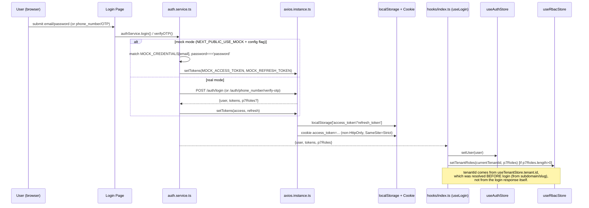
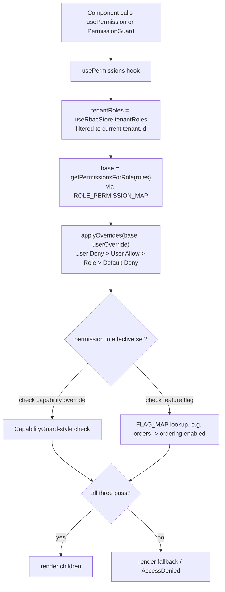
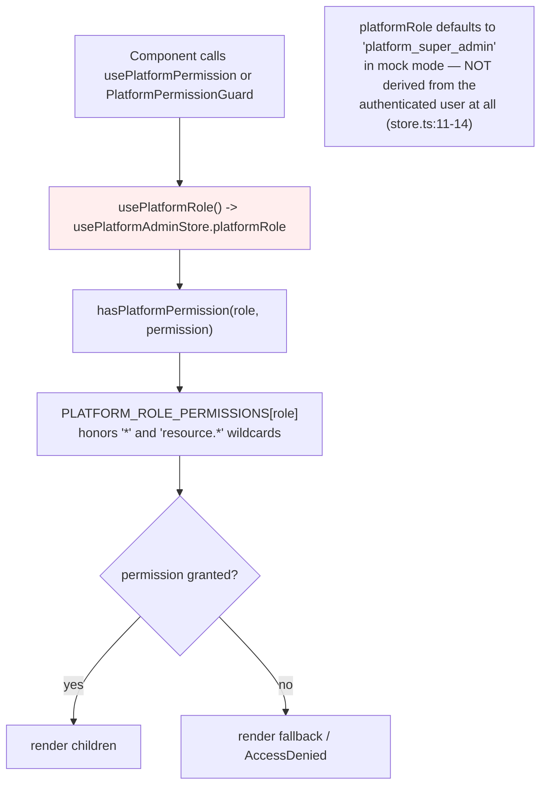
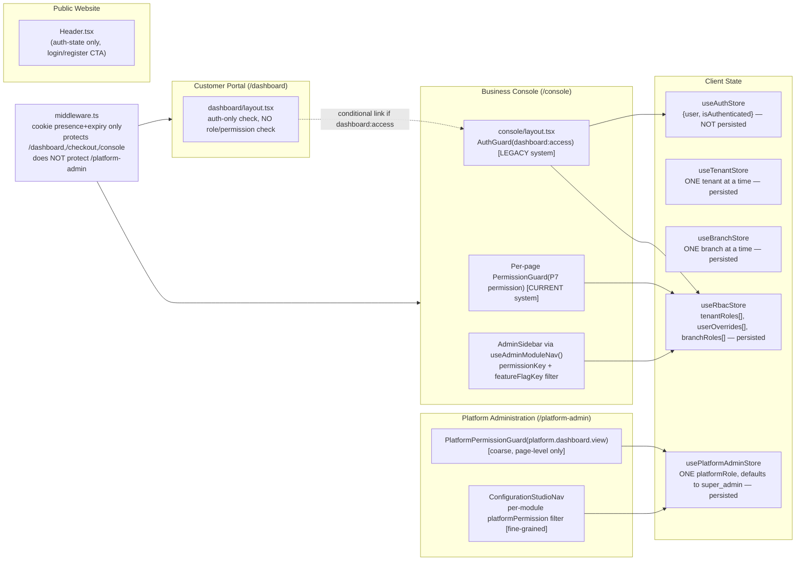
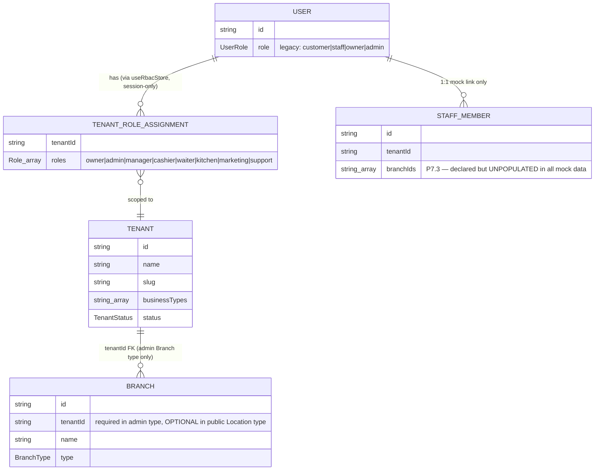

# P10.0 — RBAC, Ownership & Access Model Audit

**Status: ANALYSIS ONLY. No code was modified, renamed, refactored, or created as part of this phase, per explicit instruction.** This document is the single source of truth for the *current* authorization/ownership implementation, to be used as the baseline before any redesign work. Every claim below is sourced to an exact file and line number; nothing is inferred from naming conventions alone.

---

## Phase A — Current Authorization Architecture

### A.1 Inventory of every authorization mechanism found

| Mechanism | File | What it does |
|---|---|---|
| Master auth switch | `src/config/modules/authentication.ts` via `authFlag()` (`src/services/auth.service.ts:34-50`) | Config-driven kill switch; every auth call throws if `authentication.enabled` is off |
| Login (mock + real) | `src/services/auth.service.ts:88-117` | Mock: 10 hardcoded demo accounts; Real: POST to backend, `setTokens()` |
| Phone/OTP | `src/services/auth.service.ts:181-262` | `sendOTP()`/`verifyOTP()`, mock rejects code `'000000'`, resolves phone_number→email via `DEMO_PHONE_TO_EMAIL` |
| Token storage | `src/services/axios.instance.ts:23-75` | Access token in `localStorage['access_token']` **and** mirrored to a non-HttpOnly cookie (for Edge middleware); refresh token in `localStorage` only |
| Edge middleware | `src/middleware.ts` | Presence/expiry check on `access_token` cookie for `/dashboard`, `/checkout`, `/console` only — **not** `/platform-admin`. No role/permission check. Also injects `x-tenant-slug` header on every request. |
| `AuthGuard` | `src/components/auth/AuthGuard.tsx` | Legacy, colon-notation permission check (`rbacService.hasPermission`), gates `/console` layout |
| `PermissionGuard` | `src/components/auth/PermissionGuard.tsx` | Current P7 dot-notation permission check (`usePermission`/`useAnyPermission`/`useAllPermissions`), wraps individual Console page bodies |
| `PlatformPermissionGuard` | `src/components/auth/PlatformPermissionGuard.tsx` | Separate platform-role permission check (`usePlatformPermission`), wraps `/platform-admin` route bodies |
| `CapabilityGuard` | `src/components/guards/CapabilityGuard.tsx` | Feature/business-type capability check, not RBAC |
| Tenant-scoped RBAC store | `src/stores/index.ts` (`useRbacStore`, `:445-632`) | `tenantRoles`, `userOverrides`, `branchRoles`, `roleAssignments`, `customRoles`, audit log |
| Tenant-side permission engine | `src/services/permission.service.ts` | `ROLE_PERMISSION_MAP`, `hasPermission`, `getPermissionsForRole`, `applyOverrides`, dependency graph |
| Legacy tenant permission engine | `src/services/rbac.service.ts` | Explicitly `@deprecated`, colon-notation, still the only thing `AuthGuard` calls |
| Platform-side permission engine | `src/platform-admin/permissions.ts` | Wholly separate role/permission system for `/platform-admin`, wildcard support |
| Platform role store | `src/platform-admin/store.ts` | `usePlatformAdminStore`, default role `platform_super_admin` (mock-mode default, documented as unrealistic) |
| Branch access service | `src/services/branch-access.service.ts` | `getAccessibleBranches`/`canAccessBranch`, consumes `BranchAccessContext.branchIds` |
| Console nav gating | `src/hooks/index.ts:353-368` (`useAdminModuleNav`) + `src/modules/registry.ts` | Per-item `permissionKey` + `featureFlagKey`, both must pass |
| Platform-admin nav gating | `src/components/admin/configuration/ConfigurationStudioNav.tsx:71-74` | Per-module `platformPermission` filter |
| Customer Portal gating | `src/app/dashboard/layout.tsx:44-57` | Authentication-only check, no role/permission at all |
| Configuration field permissions | `src/config/types.ts` (`ConfigFieldPermissions`) | Per-field `{view, edit}` permission strings, resolved through the same tenant permission engine |
| Feature flags | `useTenantStore.featureFlags`, `useFeatureFlag()` hook | Tenant-level capability toggles, composed with (not a substitute for) permission checks |

### A.2 Current Login Flow



**Key observation**: tenant resolution and user authentication are two independent pipelines that only meet at the point `setTenantRoles(tenantId, p7Roles)` is called. The tenant a user's roles get attached to is whatever `useTenantStore` already holds (from the URL/subdomain), not something the login response declares. This works today because there is exactly one active tenant per session, but it means "which tenant does this login belong to" is never actually asserted by the backend response — it's assumed from client-side routing context.

### A.3 Current Permission Flow (tenant-scoped / Console)



### A.4 Current Authorization Flow — Platform Administration (parallel, separate system)



**This is a structurally separate system** from A.3 — different store, different role type (`PlatformRole` vs `Role`), different permission string format (`platform.*` vs dot-notation), no per-user overrides, no tenant/branch scoping. The codebase's own comment (`src/platform-admin/permissions.ts:1-18`) states this is deliberate: "Two questions, two systems, by design."

### A.5 Current Architecture Diagram (whole system)



---

## Phase B — Current Role Model

### B.1 Tenant-scoped roles (`Role` type, `src/types/rbac.ts:9-17`)

8 roles: **`owner`, `admin`, `manager`, `cashier`, `waiter`, `kitchen`, `marketing`, `support`**.

All 8 are wired to real logic via `ROLE_PERMISSION_MAP` (`src/services/permission.service.ts:97-264`), consumed by `usePermission`/`PermissionGuard` across dozens of `/console/**` pages. Not mock-only labels — this is the live authorization mechanism for the Business Console.

- **`admin` is granted `ALL_PERMISSIONS`** (`permission.service.ts:103`), including `tenant.manage` — identical to `owner`'s grant. The doc comment on `admin` (line 102, "Everything except tenant ownership") **contradicts** the actual code, which grants tenant ownership permissions to `admin` too. This is a real, exploitable inconsistency (see Phase J).
- Dead/commented-out code sits inside the live `ROLE_PERMISSION_MAP` object literal (`permission.service.ts:99-104`) — a commented-out alternate `owner`/`admin` definition left beside the active one.

### B.2 Platform-scoped roles (`PlatformRole` type, `src/platform-admin/permissions.ts:21-31`)

10 roles: **`platform_owner`, `platform_super_admin`, `platform_admin`, `platform_support`, `platform_operations`, `platform_finance`, `platform_security`, `platform_developer`, `platform_auditor`, `platform_read_only`**.

Wholly separate from B.1's `Role` — different type, different store (`usePlatformAdminStore`, not `useRbacStore`), different permission format (`platform.*` strings vs. tenant dot-notation), wildcard-capable (`'*'`, `'<resource>.*'`). No per-user overrides, no branch scoping — "intentionally simpler" per the file's own comment.

**Not derived from the authenticated user in mock mode.** `usePlatformAdminStore`'s default `platformRole: 'platform_super_admin'` (`src/platform-admin/store.ts:11-14`) is a persisted client-side default, explicitly documented as unrealistic: "a real backend would derive this from the authenticated platform user record instead of a persisted client default." **Today, any authenticated user who can reach `/platform-admin` (a route middleware does not protect) is treated as `platform_super_admin` by default** unless something else in the app sets `platformRole` — no code path found that does so from the actual login response.

### B.3 Legacy role model (`UserRole` type, `src/types/index.ts:6`)

4 roles: **`customer`, `staff`, `owner`, `admin`**. Still live — it is what `AuthGuard` and `rbacService` (both explicitly `@deprecated`) check, and it's the type every mock `User` object in `src/lib/mock-data.ts` carries. This is a **third**, older role vocabulary, running in parallel with B.1 (which itself has no `customer` value at all — see Phase F/J).

### B.4 Role functional status summary

| Role | System | Functional or mock-only? | Where checked |
|---|---|---|---|
| `owner`, `admin`, `manager`, `cashier`, `waiter`, `kitchen`, `marketing`, `support` | P7 tenant RBAC (`Role`) | **Functional** — live permission grants, live UI gating | `PermissionGuard`, `usePermission`, `/console/**` |
| `platform_owner` … `platform_read_only` (10) | Platform RBAC (`PlatformRole`) | **Functional**, but role assignment itself is a mock default, not derived from real identity | `PlatformPermissionGuard`, `/platform-admin/**` |
| `customer`, `staff`, `owner`, `admin` | Legacy (`UserRole`) | **Functional but deprecated** — still gates `/console` entry via `AuthGuard`, everything else superseded by P7 | `AuthGuard`, `rbacService` |
| "Customer" as a role in P7 (`Role`) | — | **Does not exist.** `customer` is implicit: any authenticated user holding zero tenant `Role`s | N/A — absence confirmed by type inspection |

---

## Phase C — Permission System

### C.1 Tenant-scoped permissions (`P7Permission`, `src/types/rbac.ts:27-98`)

44 permission strings across 16 resource groups: orders (6), menu (2), reservations (2), customers (4), payments (2), tables (2), kitchen (2), vendors (2), promotions (2), loyalty (2), analytics (2), staff (5), branches (2), settings (2) + `featureflags.manage`, tenant (2), audit (3), notifications (3), operations (2), reviews (2), plus legacy compat `dashboard:access`.

**Type/const drift found**: the `P7Permission` type includes `reviews.view`, `reviews.manage`, `dashboard:access`, but the `ALL_PERMISSIONS` const array (`permission.service.ts:26-93`) — which backs `ROLE_TEMPLATES` and `resolveEffectivePermissions` — **omits all three**. Any UI that iterates `ALL_PERMISSIONS` (e.g. role-builder screens) can never surface or grant these three permissions even though the type system allows it.

### C.2 Sample permission traces (5 permissions)

| Permission | Granted to | Checked at |
|---|---|---|
| `orders.manage` | owner, admin, manager, waiter, cashier | `src/app/console/page.tsx:36,47` (console landing view) |
| `staff.manage` | admin, owner, manager | `PermissionGuard` on `/console/staff`, `/console/roles`, `/console/users`, `/console/permissions/*` (7+ page files) |
| `tenant.manage` | admin (via `ALL_PERMISSIONS`), owner | `usePermission('tenant.manage')` in `ConfigurationModulePage.tsx:66` (gates `isPlatformAdmin` UI!), `console/page.tsx:28` |
| `settings.manage` | admin, owner (not manager/cashier/waiter/kitchen) | `PermissionGuard` on `/console/settings/feature-flags` |
| `analytics.export` | admin, marketing | Declared dependent on `analytics.view` in `PERMISSION_DEPENDENCIES` |

### C.3 Platform-scoped permissions (`PlatformPermission`, `src/platform-admin/permissions.ts`)

Pattern `platform.<resource>.<action>` (e.g. `platform.dashboard.view`, `platform.users.manage`, `platform.businesses.manage`). `PlatformPermission` is a **plain `string`** type (not a closed union) — any string satisfies the TypeScript contract, so there is no compile-time protection against a typo'd permission string silently never matching anything.

### C.4 Configuration-field permissions

`ConfigFieldPermissions` (`src/config/types.ts`) attaches `{view, edit}` permission strings to every individual configuration field, resolved through the same tenant permission engine (C.1) for `/console/settings/configuration` and the platform engine (C.3) for `/platform-admin`. This is a third dimension of permission-checking layered on top of the module/page-level checks — a field can be visible on a visible page but still individually locked.

---

## Phase D — Tenant Model

### D.1 Types

**`Tenant`** (`src/types/index.ts:299-322`): `id, name, slug, businessTypes: string[], status, createdAt, settings?`. **No `ownerId`/`ownerUserId` field — no FK to any user at all.**

**Two competing `Branch` type definitions:**
- Public/customer-facing `Location` (aliased `Branch`, `src/types/index.ts:348-370`): `tenant_id` is **optional**.
- Admin `Branch` (`src/types/branch.ts:51-66`, P7.3): `tenantId` is **required**.

Stores alias-import both separately (`Branch` vs `AdminBranch`, `src/stores/index.ts:32-33`) specifically to avoid the name/shape collision — itself evidence the two types should probably be one.

**No `Business`/`Organization` entity distinct from `Tenant`.** "Business" appears only as vocabulary (`BusinessType`, module labels) — always resolving back to `Tenant`.

**`Owner` is a role string, not an entity.** `UserRole` includes `'owner'`; there is no `interface Owner`. `User` has no tenant/business linkage field at all.

### D.2 Current hierarchy (as implemented, not as intended)



**No edge exists from `USER` to `TENANT` for ownership.** The only USER↔TENANT link in the current system is `TENANT_ROLE_ASSIGNMENT`, which is a **session-scoped RBAC role grant** (who can act as what, in which tenant), not an ownership record (who owns the business). These are conflated in the current implementation: a user with `owner` *role* in a tenant is being treated as if they own it, but there is no data structure that actually asserts ownership independent of role assignment.

### D.3 Relationships, inheritance, isolation rules found

- **Resolution order** (per `docs/BACKEND_API_CONTRACT.md` §"Resolution order" and the P9.0 config system): Platform → Tenant → Branch → User, for configuration values. This is the one place a formal hierarchy is documented and implemented (`src/config/resolver.ts` per prior P9.0-era phases).
- **Tenant isolation for RBAC**: `useRbacStore.tenantRoles` is filtered by `tenantId` before permission resolution (`usePermissions` hook) — role grants don't leak across tenants *in the RBAC layer*.
- **Tenant isolation for DATA is inconsistent** (see D.4/Phase E): some services filter by `tenantId`, others don't.
- **Session model is single-tenant**: `useTenantStore.tenant` holds exactly one `Tenant`, not a list. Switching tenants (`AdminTenantSwitcher`) fully tears down and reloads client state rather than holding multiple tenants concurrently.

### D.4 Current assumptions and problems

1. **Ownership is conflated with role.** "Is this user the owner of this tenant" is answered today by "does this user hold the `owner` role in this tenant's `TenantRoleAssignment`" — there is no separate, persistent ownership record. If a platform admin reassigns the `owner` role away from someone, the system has no memory that they were ever the legal/business owner.
2. **No multi-tenant ownership model.** Nothing in `Tenant`, `User`, or any store expresses "this Owner user owns tenants X, Y, Z." The closest primitive, `TenantMembership`/`UserTenantRole` (`src/types/staff.ts:57-67`, `src/types/rbac.ts:100-111`), models *membership with a role*, not *ownership*, and is only exercised by one out of ~19 mock RBAC users (`user-multi-01`, see Phase H).
3. **Tenant switcher shows every tenant, not owned tenants.** `AdminTenantSwitcher` sources its list from `tenantService.getTenants()` → all of `MOCK_TENANT_LIST`, gated only by the coarse `tenant.view` permission — not filtered by any ownership relationship. Today, "which tenants can I switch to" and "which tenants do I own" are the same question only by accident (because the demo grants `tenant.view` narrowly), not because the system enforces it structurally.
4. **`Branch.tenantId` optionality is a live data-integrity gap** — the type used by customer-facing/public code (`Location`/`Branch` in `index.ts`) allows a branch with no tenant link at all, while the admin type requires it. Two branch records built from the two different type paths are not guaranteed to be reconcilable.
5. **Platform Administration's own Tenant registry has no ownership link either.** `platform.tenants` (Platform Admin module) exposes `status/plan/business_type/verified/flagged_for_review/notes` per tenant — no `ownerId`. Its sibling module `platform.business_owners` is **not a registry of owner entities at all**, just three global policy toggles (`require_verified_email`, `require_verified_phone`, `max_owned_businesses`). There is currently no queryable list of "which user owns which tenant(s)" anywhere in the system, Console or Platform Administration.

---

## Phase E — Branch Model

### E.1 Branch ownership

No ownership field exists on `Branch` at all — only `tenantId` (required in the admin type, optional in the public type) and, separately, `managerId?` on the admin `Branch` (`src/types/branch.ts:51-66`) — a manager assignment, not an ownership record. A branch's "owner" today is inferred transitively: whoever owns/has the `owner` role on the branch's tenant.

### E.2 Branch selection / switching

`AdminBranchSwitcher.tsx`: sources its list via `useAdminBranches(tenant?.id)` → `branchManagementService.getBranches(tenantId)`, filtered **only by the currently active tenant** — not by any per-user/staff assignment. Auto-selects `branches[0]` when nothing is active. No ownership or staff-assignment filtering happens here either.

### E.3 Branch permissions

`branches.view`/`branches.manage` exist as P7 permissions, gating whether the switcher/branch management pages render at all — but nothing in that check filters *which* branches within the tenant a given staff member should see; it's a binary "can you use branch features," not a scope filter.

### E.4 Branch filtering / current isolation logic

`branch-access.service.ts` (`getAccessibleBranches`, `canAccessBranch`, `filterByAccessibleBranches`) is a real, generically-written mechanism: filters branches by `tenantId`, then by `context.branchIds` **unless** the actor holds `branches.manage` (in which case they see the whole tenant's branches). Consumed by `order-routing.service.ts`.

**The mechanism exists but has no live data feeding it.** `StaffMember.branchIds?: string[]` (`src/types/staff.ts:23-40`) is explicitly documented as "P7.3 branch readiness ... currently unused," and confirmed via grep: **no mock staff record anywhere populates `branchIds`.** So `branch-access.service.ts` is exercised only by direct unit tests (`src/test/phase7-order-routing.test.ts`) supplying a synthetic `BranchAccessContext`, never by the actual staff mock data → UI path. In the running app today, there is effectively no staff member with a non-empty, restricted branch scope.

### E.5 Current branch isolation — data layer, by service

| Service | Filters by `tenantId`? | Filters by `branchId`? |
|---|---|---|
| `staff.service.ts` | Yes (`:467`, `:487`) | No |
| `branch-access.service.ts` | Yes | Yes (via `context.branchIds`, unpopulated in practice) |
| `admin.service.ts` (customers) | Yes (`:81`) | Only reservations, when `filters.branch_id` explicitly supplied (`:128`) — customer notes/tags/analytics/coupons are tenant-only |
| `notification.service.ts`, `audit-log.service.ts`, `realtime-operations.service.ts` | Yes | Yes (consistently) |
| **`order.service.ts`** | **No** — `getOrders()` returns all `MOCK_ORDERS` unfiltered (`:60-69`), despite `Order.branch_id` existing on the type | **No** |
| **`menu.service.ts`** | **No** — `getItems`/`getCategories`/`getFeatured`/`getPopular`/`getRelated` (`:21-104`) have no filtering at all | **No** |

### E.6 Problems

1. Branch scoping for staff is architecturally present (`branchIds`, `BranchAccessContext`, `branchAccessService`) but **dead in practice** — no data populates it.
2. **Order and menu data are not tenant/branch-isolated at all** in the mock service layer — this is the single most consequential isolation gap found in this audit, since orders and menu items are core business data.
3. Two different `Branch` shapes (optional vs. required `tenantId`) create ambiguity about whether a branch can exist without a tenant.
4. `managerId` (one manager per branch) is a weaker, different concept than "staff assigned to this branch," and the two are not reconciled — a branch's manager isn't necessarily reflected in any staff member's `branchIds`.

---

## Phase F — User Visibility (per role, as currently implemented)

**Important caveat established in Phase D/E: because ownership isn't a real data structure and branch scoping isn't populated, "visibility" below describes what the PERMISSION SYSTEM allows, not what a properly scoped owner/staff member would see in a correctly built product.** In the current code, visibility is gated by *role → permission → page/query*, with almost no additional ownership or branch-scope filtering layered on top except where Phase E.5's table shows it.

### Admin (tenant role, `admin`)
- **Visible Users/Staff**: all staff in the current tenant (`staff.manage` granted) — `staff.service.ts` filters by `tenantId` only, so all staff of that one tenant.
- **Visible Tenants**: technically every tenant in mock data if also holding `tenant.view` (used for the Platform-Admin-labeled Tenant switcher that lives inside Console — see Phase D.4 confusion) — NOT filtered by ownership.
- **Visible Branches**: all branches of the current tenant (branch switcher has no per-user filter).
- **Visible Customers**: all customers of the current tenant (`admin.service.ts` tenant-filtered).
- **Visible Orders**: **all mock orders globally** — `order.service.ts` has no filter at all, so in principle this is also true for every other role that can reach the Orders page, not just admin.
- **Visible Reservations**: tenant-filtered, additionally branch-filterable if a `branch_id` param is supplied.
- **Visible Analytics**: tenant-scoped (via `analytics.view`).
- **Visible Settings**: full — `settings.manage`, `tenant.manage` both granted to `admin`, identically to `owner`.

### Owner (tenant role, `owner`)
- Identical visibility profile to `admin` in the current system, since `owner`'s permission grant is a superset that also includes everything `admin` has, and no ownership-based additional restriction exists anywhere. **The intended distinction between Owner and Admin (Phase K) does not exist in the current implementation — they are functionally the same role today except for whichever few permissions are `owner`-exclusive.**

### Staff (`manager`/`cashier`/`waiter`/`kitchen`/`marketing`/`support`)
- Visibility is determined by whichever permission subset `ROLE_PERMISSION_MAP` grants that specific role — e.g. `kitchen` sees `kitchen.view/manage`-gated pages, `marketing` sees `promotions`/`analytics.export`-gated pages.
- **Not scoped by branch** in practice (Phase E.6) — a `waiter` role, if granted `orders.view`, sees the same unfiltered global order list as `admin` would, because `order.service.ts` doesn't filter by branch or by the requesting user at all.
- **Not scoped by "assigned branch(es)"** — the `branchIds` mechanism that should restrict this is unpopulated.

### Customer
- Not a `Role` in the P7 system at all (see B.4) — "customer" is anyone authenticated with zero tenant role assignments, or, in the legacy `UserRole` type, an explicit `'customer'` literal.
- **Visible Orders/Reservations/Addresses/Favorites**: `/dashboard/**` pages call unparameterized service methods (`useOrders()`, `getReservations()`, `getAddresses()`) — **no client-side filtering by the logged-in customer's id at all.** In mock mode, every logged-in customer sees the exact same hardcoded arrays (e.g. `getAddresses()` returns a literal 2-address array unrelated to `useAuthStore().user`). In real mode, isolation is 100% delegated to the backend inferring identity from the token — the frontend has no safety net if that inference is ever wrong.
- **Visible Tenants/Branches/Settings/Console/Platform Admin**: none — `/dashboard/layout.tsx` requires only authentication, and the one Console cross-link is gated behind `dashboard:access`, which `customer` role never has. `AuthGuard` on `/console` independently blocks direct navigation. Confirmed: a plain customer cannot reach Console or Platform Admin content.

---

## Phase G — Navigation Visibility

### G.1 Business Console (`AdminSidebar.tsx` + `useAdminModuleNav()`)
Every nav item declares `permissionKey` (required) and optionally `featureFlagKey`; both must pass (`src/hooks/index.ts:359-367`). Grouped for display by `GROUP_ORDER` (Operations/Content/Customers/Analytics/People/Platform/System). A few items (e.g. Customers) omit the feature-flag check but still require a permission. The footer's "Customer Dashboard" / "Log out" links bypass the filtered nav array entirely (always rendered).

### G.2 Platform Administration (`ConfigurationStudioNav.tsx` + `nav-groups.ts`)
Filters **per module** via `hasPlatformPermission(platformRole, m.platformPermission)`; modules with no `platformPermission` (pre-P9.4 Configuration Studio modules) are shown to every platform role unconditionally. `nav-groups.ts`'s 13 IA groups are purely a display-ordering/bucketing constant applied *after* the permission filter, not a filter of their own.

**Route-level guard is coarser than nav-level guard**: the page/route wrapper (`PlatformPermissionGuard permission="platform.dashboard.view"`) only checks one blanket permission regardless of which specific module is being opened. The fine-grained per-module check only happens in the nav filter (G.2). **A user who navigates directly to `/platform-admin/<moduleId>` for a module they lack the specific `platformPermission` for would still pass the page guard** (since it only checks `platform.dashboard.view`) and could see that module's content — a genuine nav-vs-route consistency gap.

### G.3 Customer Portal (`/dashboard`)
Hard-coded nav item list (`DASHBOARD_MODULE.navItems`), no per-item permission or feature-flag gating at all. Fully separate route tree/layout from Console and Platform Admin — no shared nav component. One intentional cross-link (Console access, gated on `dashboard:access`) and one always-shown reverse link (Console's "Customer Dashboard" shortcut, ungated).

### G.4 Public website
`Header.tsx` conditionally renders login/register vs. user-menu/notification UI based on plain `isAuthenticated` — no console/platform links appear here, and one branch (`pathname.startsWith('/console')`) is dead code since the public `Header` never actually mounts on Console routes.

### G.5 "Configuration Studio" vs. "Platform Studio"
**"Platform Studio" does not exist as a distinct concept anywhere in the codebase** (`grep -rni "platform studio"` → zero matches, confirmed by direct search). "Configuration Studio" (P9.3) and "Platform Administration Center" (P9.4) are two **routes** that render the exact same shared component, `ConfigurationStudioLayout` — confirmed by `src/app/platform-admin/page.tsx`'s own doc comment ("Renders the exact same `ConfigurationStudioLayout` shell the Configuration Studio (P9.3) uses"). They differ only in which modules are registered/visible and which permission guard wraps the route.

### G.6 Nav-hiding vs. page-AccessDenied pattern
Both patterns coexist deliberately:
- **Pattern A (hide the link)**: Console nav (`useAdminModuleNav`), Platform Admin nav (`ConfigurationStudioNav`), Customer Portal's one Console cross-link.
- **Pattern B (link reachable, page body shows `AccessDenied`)**: all 30+ `PermissionGuard`/`PlatformPermissionGuard` usages directly inside `/app/**/page.tsx` files — this is the defense-in-depth layer for direct-URL access, and it's where the Platform Admin's route-vs-module granularity gap (G.2) actually matters, since Pattern B there is coarser than Pattern A.

---

## Phase H — Mock Data Audit

### H.1 `src/lib/mock-data.ts` — the set actually wired into login

| Mock user | id | Legacy `role` | P7 roles (via `MOCK_CREDENTIALS`) | tenantId/branchId on the User object |
|---|---|---|---|---|
| `MOCK_USER` | 1 | `customer` | — | none |
| `MOCK_STAFF_USER` | 2 | `staff` | — | none |
| `MOCK_ADMIN_USER` | 3 | `admin` | `['admin']` (implied) | none |
| `MOCK_OWNER_USER` | 4 | **`admin`** (not `owner`!) | `['owner']` (implied) | none |
| `MOCK_CASHIER_USER` | 5 | `staff` | `['cashier']` | none |
| `MOCK_KITCHEN_USER` | 6 | `staff` | `['kitchen']` | none |
| `MOCK_MARKETING_USER` | 7 | `staff` | `['marketing']` | none |
| `MOCK_SUPPORT_USER` | 8 | `staff` | `['support']` | none |
| `MOCK_MULTI_ROLE_USER` | 9 | `staff` | `['cashier','kitchen']` | none |
| `MOCK_PLATFORM_ADMIN_USER` | 10 | `admin` | — | none |

**`MOCK_OWNER_USER`'s legacy `role` field is literally `'admin'`, not `'owner'`** — a direct data inconsistency between the legacy `UserRole` value and the P7 role it's paired with in `MOCK_CREDENTIALS`. None of these `User` objects carry a `tenantId`/`branchId` — tenant scoping is entirely external (whatever `useTenantStore` currently holds), and there is **no concept of "which tenant(s) this owner user owns"** anywhere in this fixture set. `multirole@samoon.com` demonstrates one user holding two P7 roles *in the same single tenant* — not multi-tenant, not multi-branch.

### H.2 `src/services/permission.service.ts:421-505` — `MOCK_RBAC_USERS`, a second, disconnected fixture set

9 users with `tenantAssignments: UserTenantRole[]`. Eight are single-tenant/single-role against `MOCK_TENANT_ID`. **`user-multi-01` ("Max Multi") is the one genuine multi-tenant example in the entire codebase**: `manager` on `tenant-samoon-01`, `cashier` on `tenant-brew-cafe-01`. This set uses different user ids than H.1's set, is not cross-referenced with it, and is **not used by the real login flow** (`auth.service.ts`) — only by `getMockRoles()` and RBAC test files.

### H.3 Platform-side mock data
`platform.tenants` module's `TENANT_IDS` (hardcoded array in `businesses.ts`) mirrors the six tenant slugs in `tenant.service.ts`'s `MOCK_TENANT_LIST` — but carries no owner link. `platform.business_owners` has **zero individual owner mock records** — it's global policy settings only, not a per-owner registry.

### H.4 Does mock data reflect the current (or target) architecture?

**No, on both counts.**
- Against the *current* architecture: mock data doesn't exercise the branch-scoping mechanism that exists in code (`branchIds` unpopulated everywhere), and two disconnected RBAC user fixture sets exist with no reconciliation.
- Against the *target* architecture (Phase K): there is no mock data anywhere expressing "one Owner user owns N tenants," "one Staff user is assigned to branches [x, y] and that assignment can change," or "Customer sees only their own orders" (the customer mock data is a shared, unscoped global array, the opposite of the target's strict per-customer isolation).

---

## Phase I — Backend Contract Audit

`docs/BACKEND_API_CONTRACT.md` (4765 lines) contains **three separate, not-fully-reconciled descriptions of authorization**:

1. **§18/19 "RBAC Permissions by Role" / "RBAC Permission Matrix"** (lines ~1992-2030): describes a flat 3-tier model, `customer | staff | admin`, colon-notation permissions, and explicitly cites `src/services/rbac.service.ts` as its source — **the file that is marked `@deprecated` in the actual codebase**. The document states "The frontend guards all admin pages via `AuthGuard` checking `dashboard:access`," which is true today but describes the *legacy* gate, not the primary P7 permission system that actually governs individual page/feature access.

2. **§26.1 "Multi-Tenancy" / §26.2 "RBAC"** (lines ~2707-2721): describes the *current* P7-style model accurately — per-tenant role lists (`owner, admin, manager, cashier, waiter, kitchen, marketing, support`), `(userId, tenantId, role)` checks, additive permissions, "cross-tenant data leakage is a critical security requirement." This section matches `src/types/rbac.ts`/`permission.service.ts` closely.

3. **§34 "Platform Customer Identity & Business Relationship Architecture"** (lines ~3607-3761): defines a three-layer model — `PlatformUser` (global identity) → `BusinessCustomer` (per-tenant relationship) → `BranchCustomer` (per-branch visits) — explicitly requiring the backend to scope by `tenantId` and never leak cross-tenant customer data. **No frontend implementation of this three-layer model was found anywhere in `/dashboard/**`** — customer-facing pages never reference `BusinessCustomer`/`BranchCustomer` or scope requests by tenant; this model appears to exist only conceptually for `/console/customers` admin views (i.e., the *staff-facing* view of a customer, not the customer's own portal).

### I.1 Determinations

- **Authorization model described**: the contract is internally inconsistent — §18/19 documents the deprecated legacy model as canonical while §26.2 documents the actual current P7 model, and neither section references the other or explains the relationship.
- **Ownership model described**: §34 describes a genuine three-tier customer ownership/scoping hierarchy for *customers*, but the document has **no equivalent section describing Tenant ownership by an Owner user** — nothing in the contract mirrors Phase D's finding that `Tenant` has no `ownerId`. The contract is silent on how "Owner owns multiple Tenants" (Phase K's target) would be represented server-side.
- **Permission model described**: §26.2 matches current frontend P7 permissions closely and is the more accurate/current section.
- **Tenant model described**: §26.1's isolation requirement ("reject requests where token's tenant claim doesn't match header") is stronger than what the frontend currently enforces client-side (order/menu services send no tenant-scoping param at all — Phase E.5) — the contract's expectation and the frontend's actual behavior for those two services do not match.
- **Branch model described**: no dedicated branch-ownership/branch-scoping section was found comparable to §34's customer model; branch isolation is only implied by §26.1's general tenant-isolation language.

### I.2 Explicit mismatches found

1. Contract's primary RBAC section (§18/19) cites deprecated code as the source of truth.
2. Contract's §34 customer-scoping model has no frontend counterpart in the customer-facing dashboard.
3. Contract requires strict tenant-isolation on all resources (§26.1); frontend's `order.service.ts`/`menu.service.ts` send no tenant param at all in their list calls.
4. Contract has no section modeling Tenant ownership (Owner → Tenants), which is central to Phase K's target model — this is a **gap to fill in the contract itself**, not just the frontend, before any redesign.

---

## Phase J — Conflict Detection

| # | Conflict | Evidence |
|---|---|---|
| J1 | **`admin` role is granted `tenant.manage`**, identical to `owner`, contradicting the role's own doc comment ("everything except tenant ownership") | `permission.service.ts:102-103` |
| J2 | **Dead code inline** in a live permission map | `permission.service.ts:99-104`, commented-out alternate role definitions |
| J3 | **Type/const drift**: `P7Permission` includes `reviews.*`/`dashboard:access`; `ALL_PERMISSIONS` array omits them | `types/rbac.ts:94-98` vs `permission.service.ts:26-93` |
| J4 | **Two parallel tenant-side RBAC systems** running concurrently: legacy colon-notation (`rbac.service.ts`, `@deprecated`, gates `/console` entry via `AuthGuard`) and current dot-notation P7 (`permission.service.ts`, gates everything else) | `AuthGuard.tsx` calls the deprecated service; ~19 other files call the current one |
| J5 | **Three separate role vocabularies** describing overlapping concepts: `UserRole` (legacy, 4 values incl. `customer`), `Role` (P7 tenant, 8 values, no `customer`), `PlatformRole` (10 values, wholly separate domain) | `types/index.ts:6`, `types/rbac.ts:9-17`, `platform-admin/permissions.ts:21-31` |
| J6 | **Platform role is a mock-mode client-side default, not derived from the authenticated user** — `platform_super_admin` by default | `platform-admin/store.ts:11-14` |
| J7 | **`/platform-admin` is not protected by middleware** at all (only `/dashboard`, `/checkout`, `/console` are) | `middleware.ts:10` |
| J8 | **Nav-level permission granularity (per-module) is finer than route-level guard granularity (one blanket permission)** for Platform Administration — direct-URL access could reach a module the nav would have hidden | `ConfigurationStudioNav.tsx:71-74` vs `platform-admin/page.tsx:32-38` |
| J9 | **Owner treated as a Role, not an Entity** — no `Owner` interface, no `Tenant.ownerId`; "who owns this tenant" is answered by "who currently holds the `owner` role," which can change without any ownership record surviving the change | `types/index.ts:299-322` (Tenant), absence of any Owner-entity type |
| J10 | **Tenant treated as switchable-by-permission, not owned** — `AdminTenantSwitcher` shows every tenant to anyone with `tenant.view`, not "tenants I own" | `AdminTenantSwitcher.tsx:32,38,55` |
| J11 | **Branch ownership/assignment inconsistency**: `Branch.tenantId` required in the admin type, optional in the public type; `managerId` (one manager) and `branchIds` (staff scope) are two unreconciled, partially-unpopulated assignment mechanisms | `types/branch.ts:51-66` vs `types/index.ts:348-370`; `types/staff.ts:23-40` |
| J12 | **Duplicate/disconnected mock RBAC user registries**: `lib/mock-data.ts` (wired into real login) vs. `permission.service.ts`'s `MOCK_RBAC_USERS` (test/demo-only, has the one multi-tenant example) — no shared ids, no cross-reference | Phase H.1/H.2 |
| J13 | **Mock data self-contradiction**: `MOCK_OWNER_USER`'s legacy `role` field is `'admin'`, not `'owner'` | `lib/mock-data.ts:43` |
| J14 | **Permission checked without any UI dependency (dead permission)**: — not conclusively found; `reviews.*` (J3) are defined in the type but effectively unreachable via `ALL_PERMISSIONS`-driven UI, which is a milder version of this issue |
| J15 | **UI hidden by permission but page reachable by direct link without matching scrutiny** — see J8; also applies generally since Console's `PermissionGuard` (Pattern B, Phase G.6) is the actual authority and nav-hiding (Pattern A) is cosmetic only, which is *correct* defense-in-depth for Console, but Platform Admin's Pattern B is coarser than its Pattern A (J8), which is *not* correct |
| J16 | **Order and menu data have zero tenant/branch isolation** in the service layer, despite the backend contract mandating strict isolation (§26.1) and despite `Order.branch_id` existing on the type and being set at creation | `order.service.ts:60-69`, `menu.service.ts:21-104` |
| J17 | **Customer Portal has zero client-side ownership filtering** — relies 100% on the backend inferring identity from the token, with mock mode returning identical global data to every logged-in customer | Phase F "Customer" section |
| J18 | **Backend contract documents the deprecated legacy RBAC model as canonical** (§18/19) while the frontend's real primary gate is the current P7 system (§26.2, more accurate but not cross-referenced) | `docs/BACKEND_API_CONTRACT.md` §18/19 vs §26.2 |
| J19 | **Backend contract has a full customer-ownership hierarchy (§34) with no frontend implementation**, and conversely **no tenant-ownership hierarchy at all**, despite Tenant-ownership being the central concept of the target model (Phase K) | Phase I.1 |
| J20 | **`branchIds`/`BranchAccessContext` mechanism is fully built but entirely unpopulated** — architecturally present, practically dead | Phase E.4 |

---

## Phase K — Target Model Comparison

### K.1 Target Role Hierarchy (as specified)

```
Platform Admin
     ↓
   Owner
     ↓
   Staff
     ↓
 Customer
```
Tenant and Branch are **Business Entities**, not Roles.

### K.2 Side-by-side comparison

| Aspect | Target | Current |
|---|---|---|
| Role hierarchy | 4-tier: Platform Admin → Owner → Staff → Customer | 3 unreconciled role vocabularies (legacy 4-value, P7 tenant 8-value with no `customer`, platform 10-value); "Staff" is not one role but 6 (`manager/cashier/waiter/kitchen/marketing/support`) with no shared "Staff" umbrella concept |
| Tenant | Business Entity, owned by an Owner, no role semantics | A `Tenant` type exists correctly as a data entity (good foundation), but has **no ownership field**, and is *also* effectively treated as something a `tenant.view` permission unlocks browsing of — closer to a resource-you-can-switch-into than a business-you-own |
| Branch | Business Entity, owned via its Tenant | `Branch` exists as a data entity (two competing shapes), correctly FK'd to Tenant (when using the admin shape) — reasonably close to target, main gap is the type duplication and lack of ownership chain assertion (Owner→Tenant→Branch is implicit via `tenantId` only, not verified) |
| Owner owns multiple Tenants | Required by target | **Does not exist.** No data structure anywhere expresses this. Closest primitive (`TenantMembership`) models role-membership, not ownership, and is exercised by exactly one mock user across the whole test suite |
| Owner manages Tenants/Branches/Staff/Customers/Menus/Orders/Reservations/Config *only inside owned Tenants* | Required — ownership-scoped management | **Not enforced.** Current system scopes by *current active tenant* + *role-based permission*, never by *ownership*. An `admin`/`owner` role today can act within whichever tenant is currently loaded, and — separately — `AdminTenantSwitcher` lets anyone with `tenant.view` switch into any tenant, owned or not |
| Staff visibility determined by Scope (assignable to 1+ branches, 1+ tenants, changeable) | Required | **Architecture exists, data doesn't.** `branchIds`/`BranchAccessContext`/`branchAccessService` implement exactly this concept, generically, but no mock staff record populates `branchIds`; `TenantMembership` supports multi-tenant staff conceptually but again only one demo instance exists. Staff visibility today is determined by **role → static permission grant**, not by assignable scope |
| Staff scope changeable "at any time" | Required | No UI found for an Owner to assign/reassign a Staff member's branch or tenant scope. `AdminBranchSwitcher`/`AdminTenantSwitcher` are for the *acting user's own* context, not for assigning scope to *other* staff |
| Customer: no Business/Platform Console, only Portal | Required | **Matches.** `/dashboard` is fully separate from `/console`/`/platform-admin`; `customer`-typed users cannot reach either (Phase F confirmed) |
| Customer: only own orders/reservations/addresses/wallet/loyalty/profile | Required | **Does not match.** No client-side ownership filtering exists (Phase F, J17) — mock mode literally shows every customer the same shared data; real mode has no frontend safety net if backend scoping ever fails |
| Platform Admin manages every Owner/Tenant/Branch/Staff/Customer/the whole platform | Required | **Partially matches by permission breadth** (platform roles with `'*'` can reach every Platform Admin module) but there is no Owner *entity* to manage (J9), and Platform Admin's own Tenant registry has no owner link (J10/D.4.5) — so "manage every Owner" has no concrete implementation surface to point at today |

### K.3 Summary verdict

The current system's **permission-checking machinery** (P7 `Role`/`P7Permission`, the resolver, guards, dependency graph, override system) is mature and could largely be *reused* for the target model's Staff-scope enforcement. What's structurally missing is the **ownership layer**: Tenant has no owner, Owner is a role not an entity, "owns multiple tenants" has no data shape, and Staff-to-scope assignment (though partially built) is unpopulated and has no management UI. The target model is a genuine architecture addition (ownership + dynamic scope), not a simple relabeling of existing roles.

---

## Phase L — Gap Analysis

| Current | Desired | Gap | Risk | Recommended solution | Migration complexity | Breaking change? |
|---|---|---|---|---|---|---|
| `Tenant` has no `ownerId` | Tenant is owned by exactly one Owner (Owner may own many Tenants) | No ownership FK anywhere | **High** — cannot enforce "manage only owned tenants" without this | Add `Tenant.ownerId` (or a join table if co-ownership is ever needed) server + client type | Medium — additive field, but every tenant-switcher/list query needs an ownership filter added | No (additive), but query behavior changes are functionally breaking for anyone relying on "see all tenants" |
| `owner`/`admin` are tenant *roles* with near-identical permission grants | `Owner` is a distinct entity/tier above Staff; Platform Admin is above Owner | Role hierarchy conflates "what can I do" (permission) with "what do I own" (ownership); `admin` role's scope is undefined relative to target's `Owner` | **High** — J1's `admin`==`owner` grant bug makes this worse today | Decide whether target `Owner`/`Staff` maps onto a *redesigned* `Role` enum, or whether ownership becomes an orthogonal dimension checked alongside the existing `Role`/`Permission` system | High — touches `ROLE_PERMISSION_MAP`, every `PermissionGuard` caller, mock data, and the backend contract's §18/19+§26.2 reconciliation | Likely yes for the `admin` role's meaning |
| Staff visibility = static role → permission grant | Staff visibility = dynamic Scope (branches/tenants), owner-assignable, changeable any time | No scope-assignment UI; `branchIds` unpopulated; no multi-tenant staff assignment UI | **High** — this is the single largest functional gap; today "staff scoping" doesn't work end-to-end despite the plumbing existing | Build the Owner-facing "assign staff to branch(es)/tenant(s)" UI on top of the *existing* `branchIds`/`TenantMembership`/`branchAccessService` primitives (don't rebuild the mechanism, populate and expose it) | Medium — mechanism exists, needs data population + new UI + wiring `order.service.ts`/`menu.service.ts` to actually filter (closes J16 too) | No, purely additive if scope defaults to "all" when unset (current behavior) |
| Customer Portal has zero client-side ownership filtering | Customer sees only own data | J17 | **High (security/privacy risk in principle, currently masked by single-tenant demo data)** | Add explicit `userId`/`customerId` scoping on every dashboard query, even though the backend "should" already do this — defense in depth | Low-Medium — mostly service-layer parameter threading | No |
| Two parallel tenant-RBAC systems (`rbac.service.ts` legacy vs `permission.service.ts` current) | One system | J4 | Medium — confusion risk, not a live security hole since both currently agree in practice | Migrate `AuthGuard` to the P7 system, delete the legacy service and `UserRole`'s overlap with `Role` | Medium — `AuthGuard` is the `/console` entry gate, must be replaced carefully with equivalent P7 checks (e.g. require any tenant role) | Yes, if any code still depends on colon-notation permissions |
| Platform role defaults to `platform_super_admin` client-side in mock mode, `/platform-admin` unprotected by middleware | Platform Admin identity/role comes from real authenticated session; route protected like others | J6, J7 | **High for production readiness** (currently fine only because mock mode) | Add `/platform-admin` to middleware's protected prefixes; derive `platformRole` from the authenticated user's real claim, not a persisted client default | Low-Medium | Yes, once wired to real backend, if any URL currently reachable client-side without middleware auth stops being reachable |
| Platform Admin nav filters per-module; route guard only checks one blanket permission | Consistent granularity | J8 | Medium | Make the route-level guard check the specific module's `platformPermission`, not just `platform.dashboard.view` | Low | No |
| `Order`/`Menu` services return unfiltered global data | Strict tenant/branch isolation (per backend contract §26.1) | J16 | **High** | Add `tenantId`(+`branchId` where relevant) params to `order.service.ts`/`menu.service.ts` mock + real calls | Low-Medium | No if defaults preserve current demo behavior, yes if strict filtering changes what demo users currently see |
| Backend contract documents deprecated RBAC (§18/19) as primary, and has no Tenant-ownership section | Contract matches implementation and describes ownership | J18, J19 | Medium (documentation risk, blocks accurate backend implementation) | Rewrite §18/19 to describe the P7 model as primary (reference §26.2), add a new "Tenant Ownership" section mirroring §34's customer model | Low (docs-only) — explicitly **out of scope for this audit phase** per the "DO NOT CHANGE THE BACKEND CONTRACT" rule, listed here only as a forward recommendation | No |
| Two disconnected mock RBAC user sets | One consistent, target-model-reflecting mock fixture set (owners with multiple tenants, staff with real branch scope, customers with real personal data) | J12, J13, H.4 | Medium | Design one mock fixture set that exercises: 1 Owner with 2+ Tenants, 1 Staff reassignable across branches, distinct per-customer data | Medium — touches many test files that currently import the old fixtures | Possibly, for tests asserting old fixture shapes |
| `Branch.tenantId` optional in one type, required in another | One consistent Branch type | J11 | Low-Medium | Unify the two `Branch`/`Location` shapes or clearly document why two are needed and enforce the FK everywhere | Medium (touches customer-facing + admin code) | Possibly |

---

## Phase M — Final Report

### M.1 Current Architecture — Summary

The frontend has **three coexisting, largely-independent authorization systems**: (1) a deprecated legacy `UserRole`/colon-notation system that still gates `/console`'s outer door via `AuthGuard`, (2) the current, actively-maintained P7 `Role`/`P7Permission` dot-notation system that gates almost everything else inside Console (including a config-field-level permission dimension), and (3) a wholly separate Platform Administration `PlatformRole`/`platform.*` system with its own store, defaulting to a super-admin role client-side. Tenant and Branch exist as real data types with a mostly-correct FK relationship, but carry no ownership information — "ownership" today is entirely simulated by whichever role a user happens to hold in `useRbacStore`, which is itself scoped to whatever single tenant `useTenantStore` currently has loaded.

### M.2 Strengths

- The P7 permission engine (`permission.service.ts`) is a genuinely well-built additive system: role→permission grant, user-level allow/deny overrides, permission dependency graph, audit log, and a documented "Permission AND Capability AND FeatureFlag" composition rule. This is solid infrastructure to build the target model's *Staff scope* enforcement on top of.
- `branch-access.service.ts` already implements exactly the "scope: all vs assigned" concept the target model needs for Staff — it just needs real data and a management UI.
- Tenant/Branch are cleanly modeled as data entities (not conflated with roles) in the type system, which aligns with the target's "Tenant/Branch are Business Entities, not Roles" principle — this part doesn't need rebuilding, just an ownership field added.
- Customer Portal is already fully isolated at the *route/nav* level from Console and Platform Admin (Phase F/G confirmed no leakage there) — a customer genuinely cannot reach staff/admin surfaces today.
- Console and Platform Admin's nav-hiding + page-guard double layer (Pattern A + B, Phase G.6) is a sound defense-in-depth pattern, correctly applied in Console.

### M.3 Weaknesses

- No ownership data model exists at all (Owner-entity, Tenant.ownerId, multi-tenant ownership) — this is the central gap for the entire target redesign.
- Staff scoping is unpopulated/dead in practice despite being architecturally present.
- Order and menu data have zero tenant/branch isolation in the service layer — the most consequential data-isolation gap found.
- Customer Portal has no client-side ownership filtering at all, relying entirely on an as-yet-unverified backend assumption.
- Three parallel role vocabularies with drifting/duplicated meaning (legacy `UserRole`, P7 `Role`, `PlatformRole`).

### M.4 Dead systems
- `src/services/rbac-audit.service.ts` — imported nowhere.
- Commented-out code inside `ROLE_PERMISSION_MAP` (`permission.service.ts:99-104`).
- `branchIds`/`BranchAccessContext` mechanism — built, wired into `order-routing.service.ts`, exercised only by unit tests, never by real mock data → UI flow.

### M.5 Legacy systems (still live, not dead)
- `src/services/rbac.service.ts` + `UserRole`/`LegacyPermission` — `@deprecated` but still the actual gate for `/console` entry via `AuthGuard`.
- Two disconnected mock RBAC user registries (`lib/mock-data.ts` vs. `permission.service.ts`'s `MOCK_RBAC_USERS`).

### M.6 Conflicts
See Phase J's 20-item table in full; the highest-severity are J1 (`admin` silently equals `owner`), J7 (Platform Admin unprotected by middleware), J16 (orders/menu have zero isolation), and J17 (Customer Portal has zero client-side ownership filtering).

### M.7 Security issues (as currently implemented, demo/mock context)
- `/platform-admin` is not in the middleware's protected prefix list — any unauthenticated request to that path is not redirected by the Edge check (client-side guards may still catch it, but the defense-in-depth layer that protects every other admin surface is absent here).
- `platformRole` defaults to `platform_super_admin` client-side rather than being derived from a real authenticated claim.
- `order.service.ts`/`menu.service.ts` have no tenant/branch scoping, contradicting the backend contract's own stated cross-tenant-leakage requirement (§26.1) — a real backend built to spec would close this, but the frontend currently has no equivalent safeguard.
- Customer Portal pages send no ownership-scoping parameter at all — correctness depends entirely on backend token inference with zero frontend verification.

*(These are demo/mock-context findings appropriate to this audit's scope — they are not claims about production backend behavior, which this audit did not test.)*

### M.8 Mock inconsistencies
`MOCK_OWNER_USER`'s legacy role field says `'admin'`; two disconnected RBAC mock user sets; no mock data anywhere reflects the target's core scenarios (owner with multiple tenants, staff with real changeable branch scope, isolated per-customer data).

### M.9 Backend inconsistencies
Contract's primary RBAC section documents deprecated code as canonical; contract's rich customer-ownership model (§34) has no frontend implementation; contract has no tenant-ownership section at all, despite that being the crux of the target model.

### M.10 Recommended migration order (informational only — no implementation performed this phase)
1. Define the ownership data model first (Tenant.ownerId or equivalent; Owner as identifiable, even if still `role`-based initially) — everything else depends on this existing.
2. Reconcile the three role vocabularies into one, deciding how/whether `Owner`/`Staff`/`Customer` map onto (or replace) the existing `Role` enum — this is the highest-blast-radius decision and should be made before touching UI.
3. Populate and wire the already-built Staff-scope mechanism (`branchIds`, `TenantMembership`, `branchAccessService`) with real data and a management UI, rather than rebuilding it.
4. Close the Order/Menu isolation gap (J16) — needed regardless of ownership-model timing, since it's a correctness bug today.
5. Add client-side ownership filtering to Customer Portal (J17) as defense in depth.
6. Migrate `AuthGuard`/`/console` entry off the legacy system onto P7 (J4), and protect `/platform-admin` via middleware + real platform-role derivation (J6/J7).
7. Update `docs/BACKEND_API_CONTRACT.md` to reconcile §18/19 with §26.2 and add the missing Tenant-ownership section (J18/J19) — should happen alongside step 1-2, since backend and frontend ownership models must agree before implementation starts.
8. Rebuild mock data to exercise every target scenario end-to-end (multi-tenant owner, reassignable staff scope, isolated customers).

### M.11 Estimated implementation phases (rough, for planning discussion — not a commitment)
- **P10.1**: Ownership data model + role vocabulary reconciliation (types + backend contract, no UI yet).
- **P10.2**: Staff scope population + management UI + service-layer enforcement (closes the biggest functional gap).
- **P10.3**: Data isolation hardening (Order/Menu/Customer Portal).
- **P10.4**: Legacy system retirement (`rbac.service.ts`, `AuthGuard` migration, Platform Admin middleware + real role derivation).
- **P10.5**: Mock data rebuild + regression test suite alignment.

### M.12 Risk assessment
| Area | Risk if left unaddressed |
|---|---|
| No ownership model | Cannot ship the target hierarchy at all — blocks everything else |
| Unpopulated staff scope | Staff see everything in their tenant regardless of "assignment," defeating the entire scope concept |
| Order/menu isolation gap | Cross-tenant/cross-branch data exposure once real multi-tenant data exists |
| Customer Portal filtering gap | Cross-customer data exposure risk, currently masked by shared demo data |
| Three role vocabularies | Ongoing developer confusion, bugs like J1 recurring |
| Platform Admin middleware gap | Weakest link in the whole auth chain once this surface handles real platform data |

### M.13 Priority list (highest first)
1. Fix J1 (`admin`==`owner` tenant-management grant) and J16 (order/menu isolation) — both are correctness bugs today, independent of any redesign.
2. Design the ownership data model (Tenant.ownerId, Owner concept) and get backend contract agreement.
3. Populate + expose the Staff-scope mechanism.
4. Add Customer Portal client-side ownership filtering.
5. Reconcile role vocabularies / retire the legacy RBAC system.
6. Close the Platform Admin middleware/role-derivation gap.
7. Rebuild mock data and update the backend contract to match.

---

## Methodology note

This audit was produced by five parallel, read-only research passes over the codebase (auth/middleware/guards; RBAC roles/permissions/mock users; tenant/branch model/stores; navigation visibility across all four UI surfaces; customer portal/backend contract/dead-code), each citing exact file paths and line numbers, followed by manual synthesis and cross-referencing into this single document. No file was created, modified, renamed, or refactored as part of this work, per the phase's explicit instruction. All line-number citations reflect the state of the repository at the time of this audit and should be re-verified before being used to drive implementation work, since line numbers shift as the codebase changes.
