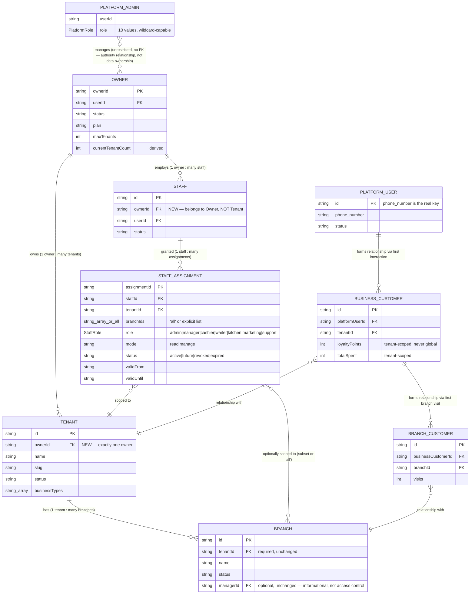
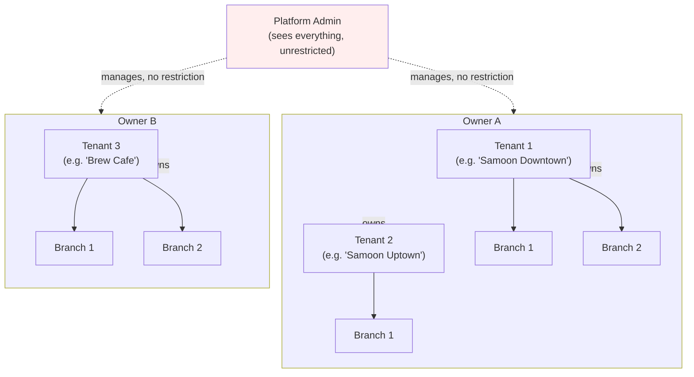
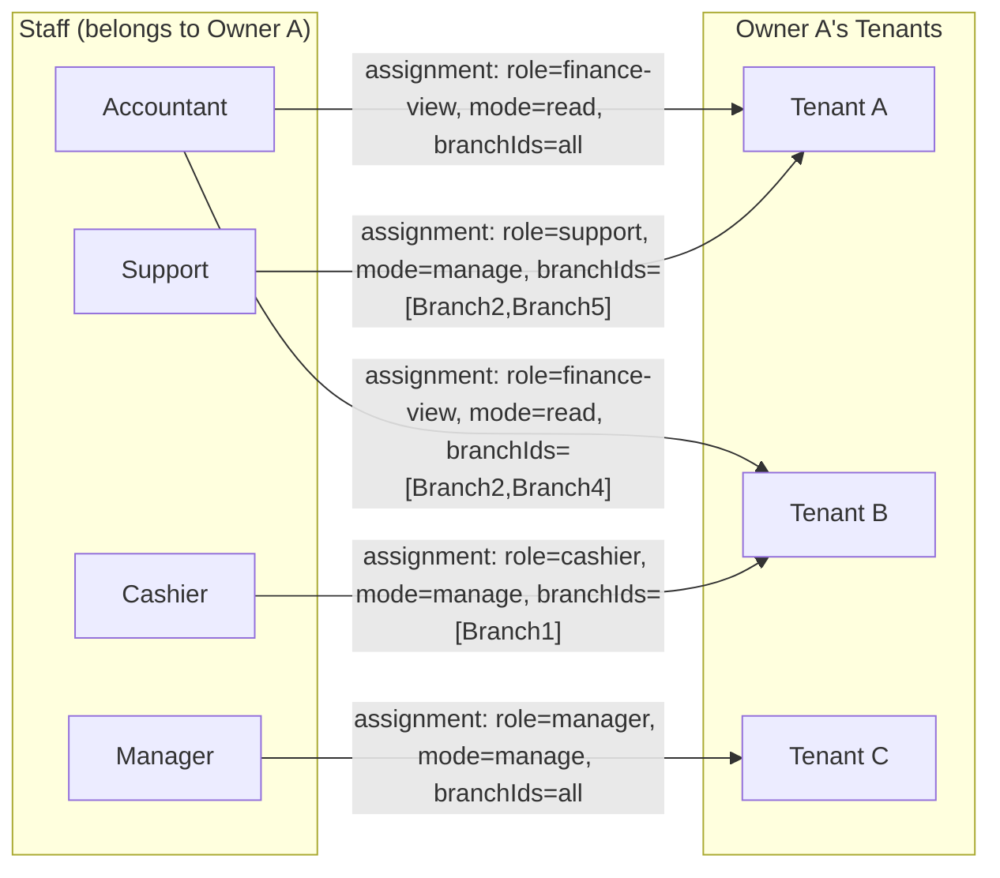
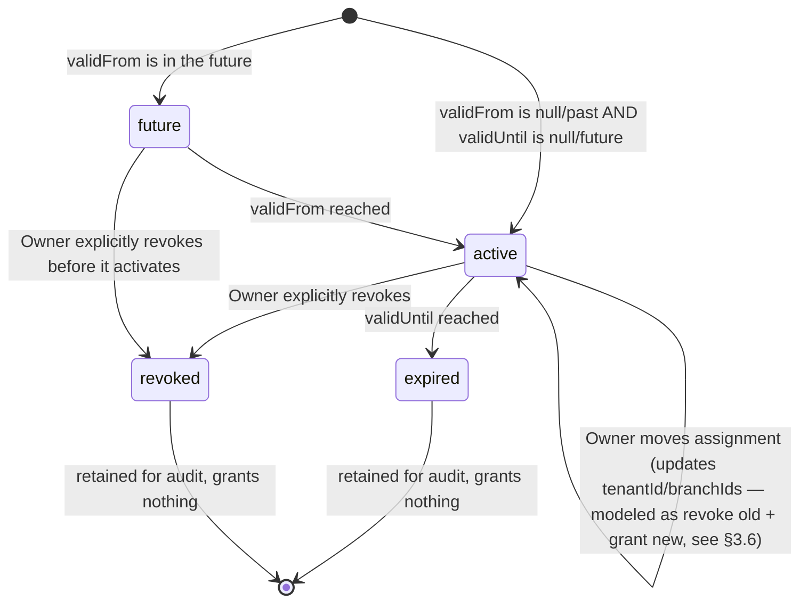
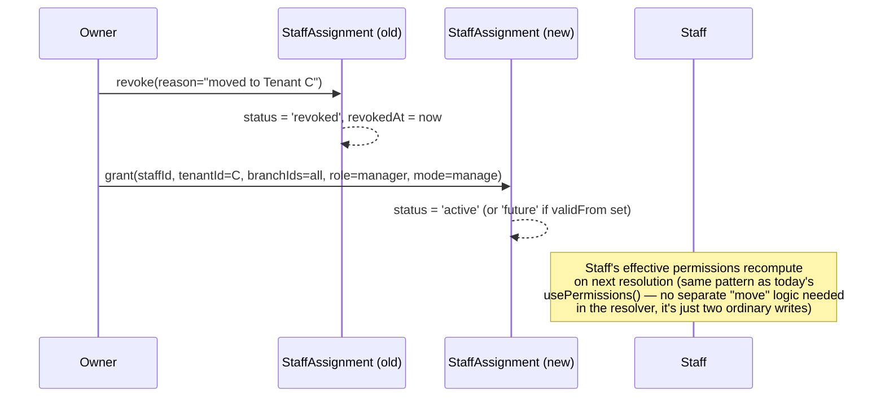
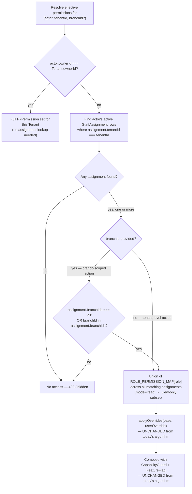
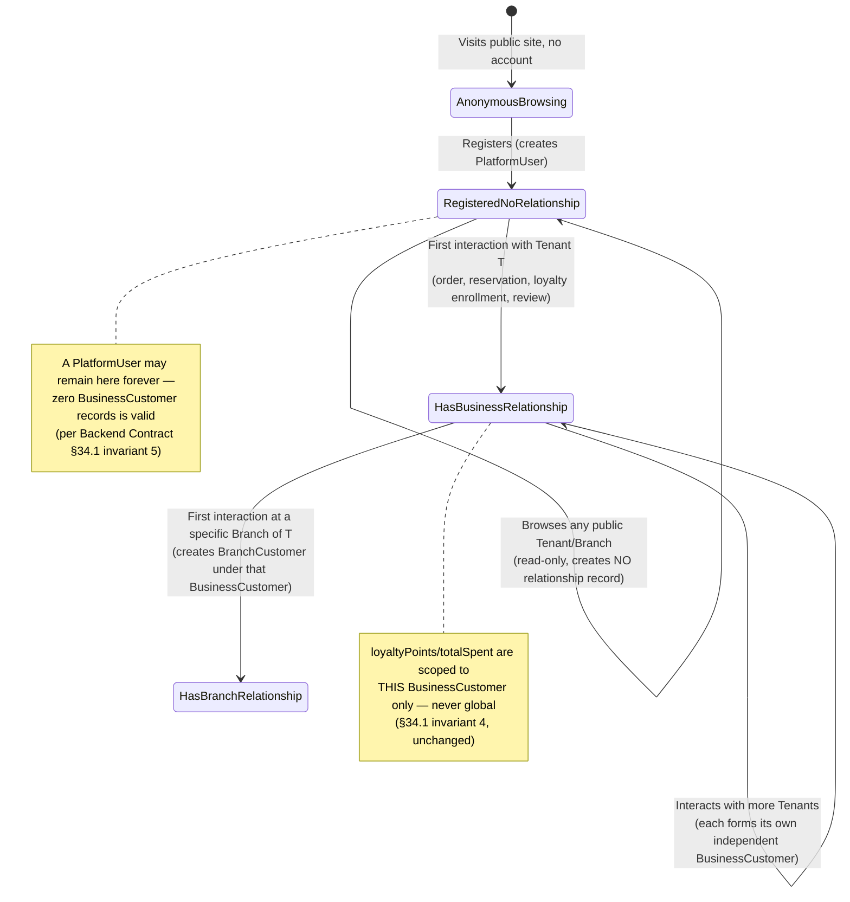
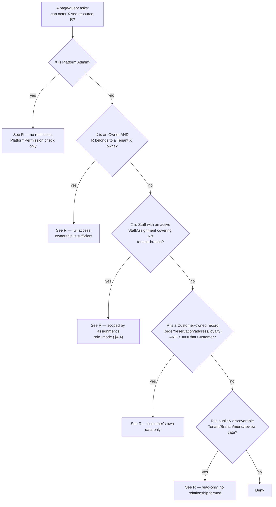

# P10.1 — Ownership & RBAC Architecture Rewrite

> **Architecture design only. No code was written in this phase.** This
> document defines the target data model, permission model, and migration
> strategy for the Owner/Tenant/Branch/Staff/Customer hierarchy. It is the
> contract every later implementation phase (P10.2+) builds against.
> Companion reading: `docs/P10.0_RBAC_OWNERSHIP_ACCESS_AUDIT.md` (current
> state), `docs/PLATFORM_ARCHITECTURE_PRINCIPLES.md` (engineering standard
> this rewrite is now part of), `docs/PLATFORM_ROADMAP.md` (where P10.x
> sits relative to P9.x), `docs/BACKEND_API_CONTRACT.md` §39 (the backend
> contract counterpart of this document).

---

## 0. Design Principles for This Rewrite

1. **Ownership is a relationship, not a role.** A `Role` string answers "what
   can this session do." Ownership answers "whose business is this." The
   current system conflates them (`owner` is both); this rewrite separates
   them structurally.
2. **Tenant and Branch are business entities, never roles.** No permission
   check anywhere should ever compare a string against a tenant id or branch
   id the way it compares against a `Role` value. (Confirmed already true in
   the current system per P10.0 Phase D — this rewrite preserves that
   correctness, it doesn't have to fix it.)
3. **Reuse, don't replace, what already works.** The P7 permission engine
   (`permission.service.ts`), the branch-access scoping primitive
   (`branch-access.service.ts`), and the Customer identity model (Backend
   Contract §34) are all sound. This rewrite adds an ownership layer and a
   formal Staff Assignment layer on top of them — it does not redesign
   permission resolution, request scoping, or customer identity from
   scratch.
4. **Every new field is additive and nullable/defaultable during migration.**
   No existing consumer of `Tenant`, `Branch`, `Role`, or `P7Permission`
   should need to change on day one of this design landing — see §8
   (Migration Strategy) for exactly what stays working unchanged and what
   requires an explicit follow-up phase.

---

## 1. Target Entity Model

### 1.1 New/changed entities

```
PlatformAdmin (existing — src/platform-admin/permissions.ts, UNCHANGED)
  — global platform staff, 10 PlatformRole values, wildcard permissions
  — sits above Owner in authority, never scoped to a tenant

Owner (NEW ENTITY — does not exist today)
  ownerId: string                    — stable identity, PK
  userId: string                     — FK to the underlying User/PlatformUser record
  status: 'active' | 'suspended' | 'pending_verification'
  plan: string                       — billing plan id (references Subscriptions module, P9.5)
  maxTenants: number                 — plan-derived ceiling (reuses existing
                                        platform.business_owners.max_owned_businesses
                                        POLICY field — see §6.3)
  currentTenantCount: number         — derived, not stored authoritatively
                                        (computed from Tenant.ownerId count)
  billing: BillingRef                — opaque reference into the Payments/
                                        Subscriptions modules, not reinvented here
  createdAt: string
  verifiedAt?: string

Tenant (EXISTING — src/types/index.ts:299-322, gains ONE new required field)
  id, name, slug, businessTypes, status, createdAt, settings   — UNCHANGED
  ownerId: string                    — NEW, required, FK to Owner.ownerId
                                        (nullable ONLY during migration — see §8)

Branch (EXISTING — src/types/branch.ts:51-66, the admin shape; UNCHANGED)
  id, tenantId, name, slug, status, type, location, contact,
  managerId?, businessHours, settings, createdAt, updatedAt   — UNCHANGED
  — tenantId already required here; this rewrite recommends (does not
    implement) retiring the public/customer-facing Location's optional
    tenant_id in favor of this one shape — see §8.5

Staff (EXISTING StaffMember type, reinterpreted — src/types/staff.ts:23-40)
  id, tenantId?, ...                — tenantId FIELD IS REMOVED FROM THE
                                        PRIMARY IDENTITY (Staff no longer
                                        belongs to a tenant directly)
  ownerId: string                    — NEW, required — Staff belongs to
                                        exactly one Owner, never directly
                                        to a Tenant or Branch
  userId: string                     — FK to underlying User record
  status: 'active' | 'suspended' | 'invited'
  — access is granted entirely through StaffAssignment (below), never
    through a field on StaffMember itself — this is the structural fix
    for "staff belongs to Owner, not Tenant" from the target hierarchy

StaffAssignment (NEW ENTITY — formalizes the existing but unpopulated
                  branchIds/BranchAccessContext primitive)
  assignmentId: string
  staffId: string                    — FK to Staff.id
  tenantId: string                   — FK to Tenant.id (must be owned by
                                        the same Owner as the Staff record —
                                        enforced invariant, see §3.3)
  branchIds: string[] | 'all'        — 'all' = every current AND future
                                        branch of this tenant; an explicit
                                        array = only those branches
  role: StaffRole                    — reuses today's Role values minus
                                        `owner` (see §4.2): admin, manager,
                                        cashier, waiter, kitchen, marketing,
                                        support
  mode: 'read' | 'manage'            — NEW dimension, orthogonal to role —
                                        see §3.4
  status: 'active' | 'future' | 'revoked' | 'expired'
  validFrom?: string                 — ISO date; assignment has no effect
                                        before this (drives 'future' status)
  validUntil?: string                — ISO date; assignment has no effect
                                        after this (drives 'expired' status)
  grantedBy: string                  — userId of the Owner (or delegated
                                        admin) who granted this
  grantedAt: string
  revokedBy?: string
  revokedAt?: string

PlatformUser / BusinessCustomer / BranchCustomer (EXISTING — Backend
  Contract §34, UNCHANGED — already matches the target Customer model
  exactly: Customer belongs to the Platform, forms a relationship with a
  Tenant/Branch only through interaction, never through ownership. See §5.)
```

### 1.2 Full ER Diagram



**Key structural facts this diagram encodes:**
- There is exactly one edge from `TENANT` to `OWNER` (`ownerId`), and it is the *only* ownership edge in the whole system — nothing else claims to "own" a tenant.
- `STAFF` has **no direct edge to `TENANT` or `BRANCH`** — every path from a Staff member to a Tenant/Branch goes through `STAFF_ASSIGNMENT`, which is exactly the "Staff receives access to multiple tenants/branches independently" requirement.
- `PLATFORM_USER`/`BUSINESS_CUSTOMER`/`BRANCH_CUSTOMER` have **no edge to `OWNER` or `STAFF` at all** — a Customer's only relationships are to `TENANT`/`BRANCH`, formed by interaction, matching "Customer belongs to Platform, not Owner."
- `PLATFORM_ADMIN`'s relationship to `OWNER` is drawn as authority (dotted), not a data foreign key — Platform Admin's reach comes from its own separate, unrestricted permission system (§4.1), not from an ownership record.

---

## 2. Ownership Diagram



This is the literal shape of the target hierarchy's "one owner ↓ many tenants ↓ many branches" — Owner A owns two entirely separate tenants (each with their own branches, settings, staff assignments, customers), and nothing about Tenant 1 and Tenant 2 is shared except that Owner A can manage both.

---

## 3. Staff Assignment Model

### 3.1 Why a separate assignment entity, not a field on Staff

A single `StaffMember.branchIds: string[]` (today's unpopulated field) cannot express "this staff member has `manager`-level access to Tenant C's every branch AND `cashier`-level access to only Branch 1 of Tenant B" — that requires **one row per (tenant, scope, role, mode)** combination a staff member holds, not one array on the staff record. `StaffAssignment` is that row.

### 3.2 Assignment Diagram — the four examples from the brief



Each arrow is one `StaffAssignment` row. The Accountant has **two independent assignments** to two different tenants with different branch scopes in each — exactly "multiple tenants, multiple branches, independently," with no upper bound on how many assignment rows one Staff member can hold.

### 3.3 Invariant: assignment tenant must belong to the assigning Owner

A `StaffAssignment.tenantId` must reference a `Tenant` whose `ownerId` equals the `Staff.ownerId` of the assignment's `staffId`. This is the mechanism that enforces "Staff belongs to one Owner" while still allowing multi-tenant access — the Owner can only grant access to tenants *they* own, never to another Owner's tenant. (Platform Admin is exempt from this invariant entirely — it doesn't use `StaffAssignment` at all, see §4.1.)

### 3.4 The `mode` dimension (read vs. management)

The brief requires "Read-only assignment" and "Management assignment" as first-class concepts. Rather than doubling the `StaffRole` enum (`cashier` vs `cashier-readonly`, etc. — combinatorial explosion), `mode` is orthogonal:

- `mode: 'manage'` — the assignment's `role` resolves permissions exactly as today's `ROLE_PERMISSION_MAP` does (full read+write for that role's resource set).
- `mode: 'read'` — the assignment's `role` resolves to the **`.view`-suffixed subset only** of that role's permission set (e.g. `orders.manage` → `orders.view`, `staff.manage` → `staff.view`), mechanically derived, not hand-maintained per role. This reuses the existing dot-suffix convention in `P7Permission` (§4.2) rather than inventing a parallel permission catalog.

### 3.5 Assignment Lifecycle Diagram



Grant / Revoke / Move / Temporary / Future / Read-only / Management — every operation named in the brief maps onto this state machine plus the `mode` dimension:

| Operation | How it's modeled |
|---|---|
| Grant | Create a new `StaffAssignment` row, `status: active` (or `future` if `validFrom` is set ahead) |
| Revoke | Set `status: revoked`, `revokedBy`, `revokedAt` — row is never deleted (audit trail) |
| Move | Revoke the old assignment + grant a new one with different `tenantId`/`branchIds` — **not** an in-place mutation of `tenantId`, so the audit trail shows exactly when a staff member's scope changed and to what |
| Temporary assignment | Set `validUntil` at grant time |
| Future assignment | Set `validFrom` ahead of now at grant time |
| Read-only assignment | `mode: 'read'` |
| Management assignment | `mode: 'manage'` |

### 3.6 Transfer/Move Diagram



---

## 4. Permission Model

### 4.1 Platform Permissions — unchanged, confirmed correct

`PlatformRole`/`PlatformPermission` (`src/platform-admin/permissions.ts`) require **no design change**. The P10.0 audit's only finding here was operational (mock-mode default role, middleware gap — both implementation concerns for P10.2+, not architecture). Platform Admin sits structurally above Owner in the hierarchy (§2) but its permission *resolution* stays exactly as it is: role → wildcard-capable permission set, no tenant/branch scoping, no per-user overrides. This is correct for a platform-wide operator role and should not be forced into the Owner/Staff scoping model.

### 4.2 Owner Permissions

An Owner does **not** receive permissions through a `StaffAssignment` or a `TenantRoleAssignment` row. Ownership itself is the grant: **an Owner has full `P7Permission` access to every Tenant where `Tenant.ownerId === Owner.ownerId`, structurally, with no assignment record needed.** This is the fix for the current system's J1 finding (P10.0) — `admin` role currently gets `tenant.manage` identical to `owner` because there is no structural way to say "only the actual owner can do this." Under this design:

- The `owner` value is **removed from the assignable `Role`/`StaffRole` enum** (§4.3) — nobody is ever *assigned* the `owner` role via `StaffAssignment`, because ownership isn't an assignment.
- Permission resolution for "is this actor allowed to do X in Tenant T" becomes: **first** check `actor.ownerId === T.ownerId` (full access, short-circuit) — **then**, only if not the owner, resolve via that actor's `StaffAssignment` rows scoped to `T` (§4.4).
- `tenant.manage`/`tenant.view` (the two most sensitive permissions in the current catalog) become **owner-only, structurally unreachable via any `StaffAssignment`**, closing J1 permanently rather than patching the current map by hand.

### 4.3 Staff Permissions

`StaffRole` = today's `Role` type minus `owner`: **`admin`, `manager`, `cashier`, `waiter`, `kitchen`, `marketing`, `support`**. `ROLE_PERMISSION_MAP` (`permission.service.ts`) is **reused as-is** for these 7 roles — no permission grants change for any of them individually. What changes is *how* a Staff member acquires a role: via a `StaffAssignment` row scoped to one `(tenantId, branchIds)` pair, not via a flat `TenantRoleAssignment` with no branch dimension.

`admin` remains the highest Staff role (full operational control within its assigned scope) but **no longer implicitly equals Owner** — `tenant.manage` is removed from `admin`'s grant (closing J1), since tenant-level ownership actions (delete tenant, transfer ownership, change billing plan) are Owner-only per §4.2, never delegable to Staff regardless of role.

### 4.4 Effective Permission Resolution (replaces `usePermissions()`'s current algorithm)



**This is the one real algorithmic change** in the whole rewrite — everything below "Union of ROLE_PERMISSION_MAP..." (override application, capability composition, feature-flag composition) is byte-for-byte what `usePermissions()` already does today (P10.0 §A.3). The new work is entirely the ownership short-circuit (B) and the branch-scope check (I), both additive checks *before* the existing algorithm runs.

### 4.5 Customer Permissions

Customers have **no `P7Permission` grants at all** — this is unchanged from today, and correctly so per P10.0's finding that Customer isn't a `Role` in the P7 system. What formalizes under this rewrite is the *access rule*, stated explicitly for the first time:

> A Customer (`PlatformUser`) may read/write only records where `BusinessCustomer.platformUserId === self.id` (and transitively `BranchCustomer.businessCustomerId` under that). A Customer may **browse** (read-only, no ownership relationship required) any Tenant/Branch marked publicly discoverable, and any such browsing action **never** creates a `BusinessCustomer`/`BranchCustomer` record — only an actual interaction does (§5).

This requires **zero changes to `P7Permission`, `PlatformPermission`, or `StaffAssignment`** — it's a data-scoping rule enforced at the query/service layer (already partially true — Backend Contract §34's invariants say exactly this), formalized here as the fourth, structurally distinct branch of the access model, sitting outside the RBAC hierarchy entirely (matching the target's "Customer belongs to Platform, NOT to Owner, NOT to Tenant, NOT to Branch").

---

## 5. Customer Lifecycle (Public Browse → Owned Relationship)



This lifecycle already exists, correctly, in Backend Contract §34 — this rewrite's contribution is connecting it explicitly to the Owner/Staff hierarchy above: nothing in this lifecycle ever touches `Owner`, `Staff`, or `StaffAssignment`. A Customer's journey and a Staff member's assigned scope are entirely orthogonal systems that only meet at the data level (a Staff member with an assignment to Tenant T can see Tenant T's `BusinessCustomer` records; a Customer never sees any Staff/Owner data at all).

---

## 6. Access Diagram — "who sees what," by hierarchy level



---

## 7. Permission Definitions (by tier)

### 7.1 Platform Admin
Unchanged from today (`PLATFORM_ROLE_PERMISSIONS`, `src/platform-admin/permissions.ts`) — 10 roles, `platform.<resource>.<action>` strings, wildcard-capable. Explicitly reaffirmed as: can manage every Owner, every Tenant, every Branch, every Staff, every Customer, every Module, with no restriction, per the brief.

### 7.2 Owner
Not a permission *list* — a structural grant. An authenticated actor with `Tenant.ownerId === self.ownerId` has every `P7Permission` for that tenant, always, including the two now-owner-exclusive permissions `tenant.manage`/`tenant.view` (§4.2) and the new ownership-transfer action (§8's migration notes / Backend Contract §39.4). An Owner's authority never extends to a Tenant they don't own (no "Owner sees every tenant" — that's Platform Admin's privilege, not Owner's).

### 7.3 Staff
`ROLE_PERMISSION_MAP[role]` (unchanged 7-role map, `owner` removed) filtered by the assignment's `mode` (§3.4), and only for tenants/branches an active `StaffAssignment` names (§4.4). A Staff member with assignments to 3 different tenants effectively has 3 independent permission sets, resolved per-request based on which tenant the current page/query is scoped to.

### 7.4 Customer
No `P7Permission`/`PlatformPermission` grants. Access is defined entirely by the ownership-of-own-record rule (§4.5) plus unrestricted read access to publicly discoverable data.

---

## 8. Review of Existing RBAC Checks — Obsolete / Duplicate / Conflicting / Dead / Legacy

*(Full detail already captured in `docs/P10.0_RBAC_OWNERSHIP_ACCESS_AUDIT.md` Phase J — this section restates each finding as an explicit disposition under the new architecture, per this phase's requirement to "review every existing RBAC check.")*

| Finding (P10.0 ref) | Disposition under this rewrite |
|---|---|
| J1 — `admin` silently granted `tenant.manage`, same as `owner` | **Resolved by design** (§4.2/§4.3) — `tenant.manage` becomes structurally owner-only, not a map entry any Staff role can hold |
| J2 — dead commented-out code in `ROLE_PERMISSION_MAP` | **Cleanup item for P10.2** (code change, out of scope here) — remove when `ROLE_PERMISSION_MAP` is edited to drop `owner` |
| J3 — `P7Permission` type/`ALL_PERMISSIONS` const drift (`reviews.*`, `dashboard:access` missing from the array) | **Cleanup item for P10.2** — no architectural change needed, just reconcile the two lists |
| J4 — two parallel tenant RBAC systems (legacy `rbac.service.ts` vs. current `permission.service.ts`) | **Legacy system formally deprecated, not deleted, in this design.** `AuthGuard`'s `dashboard:access` check is superseded by "does this actor have ANY active `StaffAssignment` OR are they an `Owner`" — see §8.1 below for the exact compatibility shim |
| J5 — three role vocabularies (`UserRole`, `Role`, `PlatformRole`) | **Reduced to two.** `UserRole`'s `owner`/`admin`/`staff`/`customer` legacy values are retired conceptually (see §8.2); `Role` becomes `StaffRole` (7 values, `owner` removed) plus the new `Owner` entity; `PlatformRole` is untouched (it was never part of the conflict — it's correctly separate) |
| J6 — `platformRole` defaults to `platform_super_admin` client-side | **Not an architecture issue** — implementation/data-wiring concern for P10.2 (derive from real session, not a persisted default) |
| J7 — `/platform-admin` unprotected by middleware | **Not an architecture issue** — implementation concern for P10.2 |
| J8 — Platform Admin nav filters per-module, route guard only checks one blanket permission | **Not an architecture issue** — implementation concern for P10.2/P10.3 |
| J9 — Owner treated as Role, not Entity | **Resolved by design** — this entire document |
| J10 — Tenant switcher shows every tenant to anyone with `tenant.view`, not "tenants I own" | **Resolved by design** — under the new model, an Owner's tenant switcher lists `WHERE ownerId = self.ownerId`; Platform Admin's separate tenant browser (already a distinct surface, Platform Administration's `platform.tenants` module) legitimately shows every tenant, by design, per §4.1 |
| J11 — two competing `Branch` type shapes | **Recommended for consolidation** (§8.5) — not implemented here, flagged as a P10.2+ code task |
| J12 — two disconnected mock RBAC user registries | **Mock data rebuild is P10.2+ scope** — this document defines what the *correct* combined fixture set must express (§9) |
| J13 — `MOCK_OWNER_USER`'s legacy role field says `'admin'` | Same — mock data fix, P10.2+ |
| J16 — Order/Menu services have zero tenant/branch isolation | **Not resolved by this design directly** — this is a data-layer bug independent of the ownership model; still flagged highest-priority for P10.2 per P10.0's own priority list |
| J17 — Customer Portal has zero client-side ownership filtering | **Formalized by §4.5/§5** — the *rule* now exists explicitly in architecture; enforcing it in query code is P10.2+ |
| J18/J19 — Backend contract inconsistencies | **Addressed in this phase** — see `docs/BACKEND_API_CONTRACT.md` §39 (new) |
| J20 — `branchIds`/`BranchAccessContext` built but unpopulated | **Superseded by `StaffAssignment`** (§1.1/§3) — `BranchAccessContext` is not deleted; it becomes `StaffAssignment`'s runtime *resolution result* (the thing `branch-access.service.ts` computes from assignment rows), not the thing an Owner directly edits |

### 8.1 `AuthGuard`/`dashboard:access` compatibility shim

`AuthGuard.tsx`'s `requiredPermission="dashboard:access"` check on `/console/layout.tsx` (P10.0 §A.3) is the one place the legacy colon-notation system still gates something real. Under this design, `dashboard:access` becomes a **derived, computed boolean**, not a grantable permission string:

```
dashboard:access = (actor is an Owner with ≥1 owned Tenant)
                 OR (actor has ≥1 active StaffAssignment, any tenant, any role)
```

This is expressible entirely in terms of the new model (§4.2/§4.4) without touching `AuthGuard`'s external contract (`requiredPermission: LegacyPermission`) — the *check itself* stops calling `rbacService.hasPermission()` and instead evaluates the boolean above. `AuthGuard` as a component, and its prop shape, do not need to change; only its internal check does (a P10.2 implementation detail, not an architecture change here).

### 8.2 `UserRole` (legacy) retirement path

`UserRole = 'customer' | 'staff' | 'owner' | 'admin'` is not deleted by this design, but every one of its 4 values is now expressible in the new model without it:
- `'customer'` → any `PlatformUser` with no `Staff`/`Owner` record.
- `'staff'` → any `Staff` record with ≥1 `StaffAssignment` (regardless of which of the 7 `StaffRole`s).
- `'owner'` → any `Owner` record.
- `'admin'` → collapses into `'staff'` above (it's just one `StaffRole` value now, not a distinct top-level concept).

Recommendation: keep `UserRole` as a **derived, read-only convenience label** (computed from the above, for any UI still displaying "role: X" badges) rather than a stored/assigned field, once P10.2+ implements this. This document does not implement that derivation — it specifies the target shape.

### 8.3 Platform-side Tenant/Business-Owner modules

Backend Contract's / Platform Administration's `platform.tenants` and `platform.business_owners` modules (P10.0 §D.4.5) currently have no link between them at all — `platform.business_owners` isn't even a registry, just global policy fields. Under this design, `platform.tenants`'s collection schema gains one new property, `ownerId` (a real FK, resolvable to an `Owner` record), and `platform.business_owners` becomes what its name always implied: a genuine collection of `Owner` entities (§1.1), with the existing three policy fields (`require_verified_email`, `require_verified_phone`, `max_owned_businesses`) staying exactly as platform-wide policy governing what an Owner record is allowed to look like (e.g. `max_owned_businesses` directly becomes the ceiling `Owner.maxTenants` is validated against).

### 8.4 Configuration-field permissions (`ConfigFieldPermissions`)

No change. `{view, edit}` on individual config fields continues to resolve through the same `P7Permission` engine — under this design, that means a config field's `edit` permission being, say, `tenant.manage` now correctly means "Owner-only," automatically, everywhere that field is rendered, with zero per-field changes needed (this was already true structurally, just newly *correct* given §4.2's fix).

### 8.5 Branch type consolidation (recommendation, not implemented)

The public/customer-facing `Location` (`src/types/index.ts:348-370`, optional `tenant_id`) and the admin `Branch` (`src/types/branch.ts:51-66`, required `tenantId`) should converge on one shape with `tenantId` always required, since under this design every Branch structurally requires a Tenant, which structurally requires an Owner — an "ownerless, tenantless branch" is not a state the new model can represent, so the type should stop allowing it. Flagged for P10.2+ code work; not performed in this document.

---

## 9. Target Mock Data Shape (specification, not implementation)

For P10.2+'s mock-data rebuild to satisfy this architecture, the fixture set must include at minimum:

- **≥2 Owners**, one of whom (`Owner A`) owns **≥2 Tenants**.
- **≥1 Staff member with ≥2 `StaffAssignment` rows** to different tenants under the same Owner, with different `branchIds`/`role`/`mode` per assignment (realizing the Accountant example from §3.2).
- **≥1 `StaffAssignment` with `status: 'future'`** and **≥1 with `status: 'revoked'`**, to exercise the full lifecycle (§3.5).
- **≥2 `PlatformUser`s with zero `BusinessCustomer` records** (browsing-only customers) and **≥2 with `BusinessCustomer` records in ≥2 different Tenants** (realizing §5's lifecycle).
- **≥1 Platform Admin** whose role is derivable from an actual session concept, not a hardcoded store default (closing J6 in fixture form, even before the real derivation logic exists).

---

## 10. Migration Strategy

### 10.1 Breaking changes

| Change | Why it's breaking | Mitigation |
|---|---|---|
| `owner` removed from the assignable `Role`/`StaffRole` enum | Any code pattern-matching `role === 'owner'` against a `TenantRoleAssignment` stops finding matches once ownership moves off that mechanism | Keep `'owner'` as a **valid but unassignable** enum value through a transition window; new assignments never use it; existing data migrates to real `Owner` records (see 10.3) |
| `admin` role loses `tenant.manage`/`tenant.view` | Any Staff member currently relying on `admin` role for tenant-level actions loses that ability | Audit real (non-mock) `admin`-role assignments before cutover; any that need tenant-level actions must become the actual `Owner` or receive a scoped exception during transition (documented per-tenant, not a permanent carve-out) |
| `Tenant.ownerId` becomes required (post-migration) | Any Tenant record without a resolvable owner becomes invalid | See 10.3 backfill step — must run to completion before `ownerId` is enforced as non-nullable |

### 10.2 Non-breaking changes

- Adding `Owner`, `StaffAssignment` as new entities — purely additive, nothing references them yet on day one.
- Adding `ownerId` to `Tenant` as **nullable** during the transition window — every existing reader of `Tenant` that doesn't know about `ownerId` keeps working unchanged.
- `ROLE_PERMISSION_MAP`'s 7 remaining roles (`admin` through `support`) keep their existing grants except the two removed from `admin` (10.1) — every other permission check for these roles is unaffected.
- `PlatformRole`/`PlatformPermission` — entirely untouched.
- Backend Contract §34 (Customer identity) — entirely untouched, already correct.
- `branch-access.service.ts`'s existing `getAccessibleBranches`/`canAccessBranch` logic — reused as the resolution engine for `StaffAssignment`, not rewritten.

### 10.3 Deprecated models & legacy compatibility

- **`rbac.service.ts` (legacy colon-notation)**: formally deprecated by this document (already marked `@deprecated` in source, per P10.0 J4). Compatibility shim in §8.1 keeps `AuthGuard`'s external behavior identical during transition. Full removal is a P10.2+/P10.3 code task, not performed here.
- **`UserRole` type**: kept as a derived label per §8.2, no longer a source of truth once implemented.
- **`branchIds` on `StaffMember`**: superseded by `StaffAssignment`. The field itself can remain on the type as deprecated/unused (it already is, per P10.0 — no live consumer today) until a P10.2+ cleanup removes it; nothing needs it removed for this design to take effect.
- **Backfill requirement**: every existing `Tenant` record needs an `ownerId` assigned before that field can be enforced as required. Recommended backfill rule: for each Tenant, if exactly one `TenantRoleAssignment` exists with `role: 'owner'`, that assignment's `userId` becomes the seed for a new `Owner` record (creating one if the user doesn't already have one), and `Tenant.ownerId` is set to it. Tenants with zero or >1 `owner`-role assignments require manual resolution (flagged, not auto-resolved) — this is an implementation task for P10.2, specified here so it isn't invented ad hoc later.

---

## 11. Architecture Score

| Dimension | Score (1-5) | Rationale |
|---|---|---|
| Matches target hierarchy | 5/5 | Every relationship in the brief (Owner↓Tenant↓Branch, Staff independent multi-scope, Customer platform-only) is directly representable |
| Reuses existing sound infrastructure | 5/5 | P7 permission engine, branch-access scoping, Customer identity model (§34) all reused unmodified |
| Backward compatibility during transition | 4/5 | Nearly everything is additive/nullable; the one genuine breaking change (`admin` losing `tenant.manage`) is unavoidable given the target model's own constraint that tenant-management must be Owner-exclusive |
| Closes audit findings (P10.0 Phase J) | 4/5 | 12 of 20 findings resolved by design; remaining 8 are correctly identified as implementation/data tasks, not architecture gaps, and are sequenced into P10.2+ |
| Introduces new complexity | 3/5 (lower is better, scored as risk below) | `StaffAssignment` is a genuinely new concept the team must learn; mitigated by it directly mirroring the already-understood `branch-access.service.ts` scoping shape |
| **Overall** | **4.2/5** | A sound, mostly-additive design that closes the audit's central gap (no ownership model) without discarding working infrastructure |

## 12. Risk Analysis

| Risk | Likelihood | Impact | Mitigation |
|---|---|---|---|
| Backfill (10.3) finds Tenants with ambiguous ownership (0 or >1 `owner`-role holders) | Medium (likely in real, messy production data; low in this codebase's mock data) | High — blocks enforcing `ownerId` as required | Flag-and-report backfill script (not implemented here); ship with `ownerId` nullable until 100% resolved |
| `admin` role's `tenant.manage` removal breaks a real workflow no one flagged in this audit | Low-Medium | Medium | Explicit audit step in 10.1 before cutover; keep a time-boxed manual-exception path |
| `StaffAssignment` volume (one row per tenant×branch-subset×role combination) grows large for power users with many assignments | Low | Low-Medium (query performance, not correctness) | Standard indexing on `(staffId, tenantId, status)`; `branchIds: 'all'` sentinel already avoids needing one row per branch |
| Team builds P10.2 UI against this spec before backend exists, then backend §39 contract needs a revision, causing rework | Medium | Medium | §39 (Backend Contract) is written in this same phase specifically to prevent drift — implement backend and frontend against the same document simultaneously |
| Legacy `AuthGuard`/`rbac.service.ts` compatibility shim (§8.1) papers over the deprecation instead of forcing cleanup | Medium | Low | Explicitly scheduled for removal in the recommended P10.4 (§13) — not left indefinite |

## 13. Recommended Implementation Order

- **P10.2 — Data Model & Resolution Engine**: implement `Owner`, `StaffAssignment` types; implement the effective-permission resolution algorithm (§4.4) alongside (not replacing) today's `usePermissions()`; run the `Tenant.ownerId` backfill; fix J1-J3 (permission map cleanup) and J16 (Order/Menu isolation) as part of this same pass since they're pure data/logic fixes with no UI dependency. No UI changes.
- **P10.3 — Owner & Staff Management UI**: build the Grant/Revoke/Move UI for `StaffAssignment` (the actually-missing capability per P10.0's priority list); build the Owner-facing "my tenants" switcher filtered by real ownership (closing J10); wire Customer Portal client-side ownership filtering (closing J17).
- **P10.4 — Legacy Retirement**: migrate `AuthGuard` off `rbac.service.ts` onto the §8.1 derived check; delete `rbac.service.ts`/`UserRole`'s stored-field usage once nothing reads it; remove the now-dead `branchIds` field from `StaffMember`; close J6/J7/J8 (Platform Admin middleware + role derivation + nav/route guard granularity).

Each phase should re-run the full validation suite and produce its own honest completion report, per this project's established convention — this document intentionally stops at architecture, per this phase's explicit instruction not to implement.
